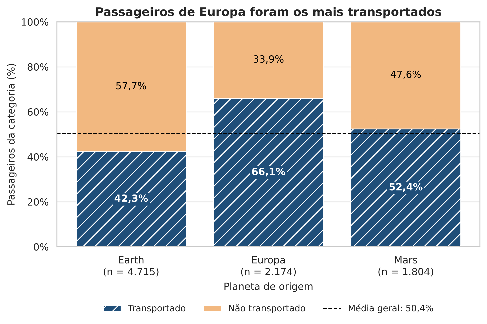
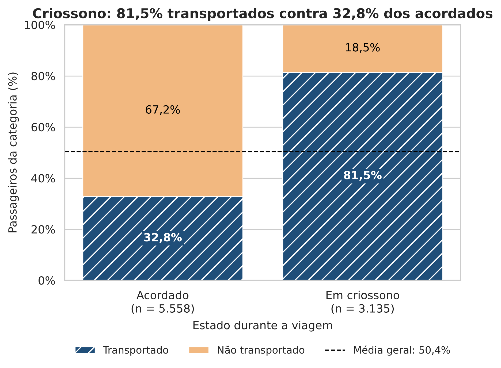
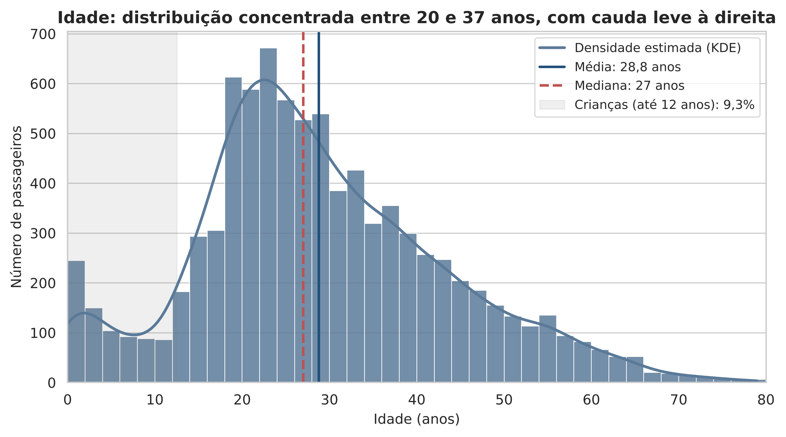
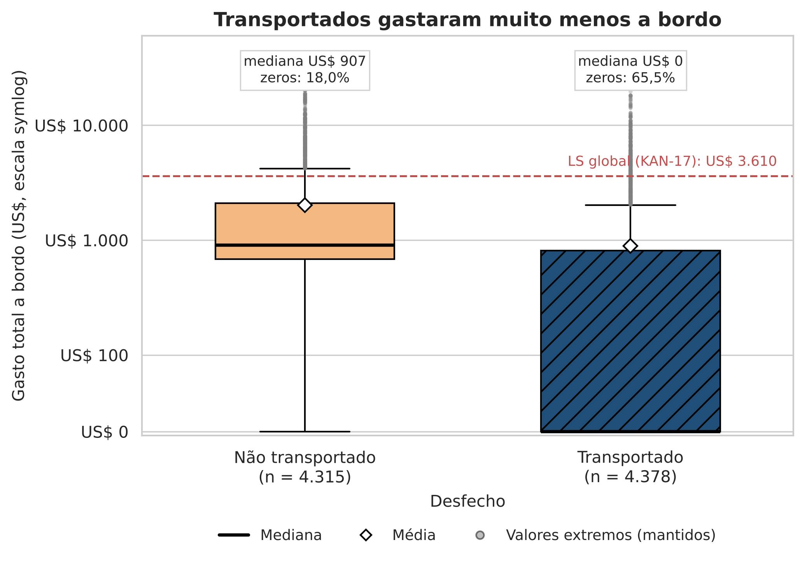
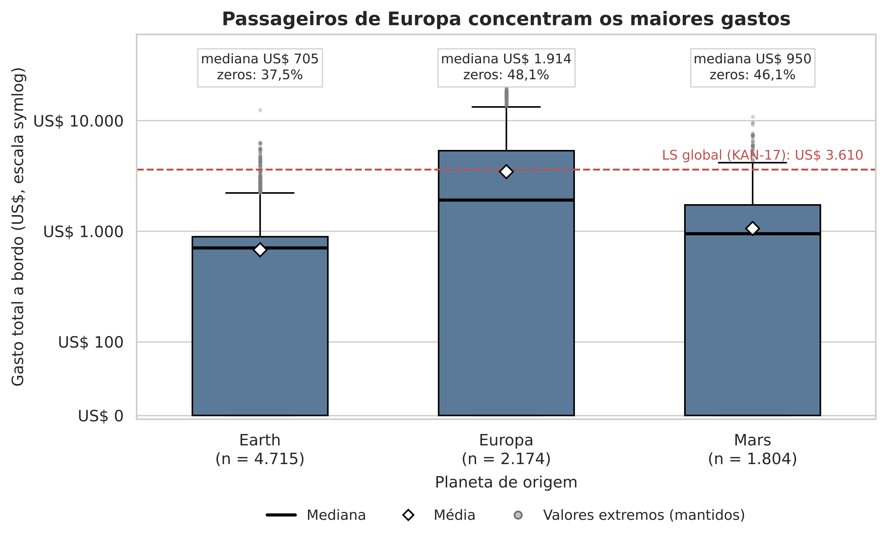
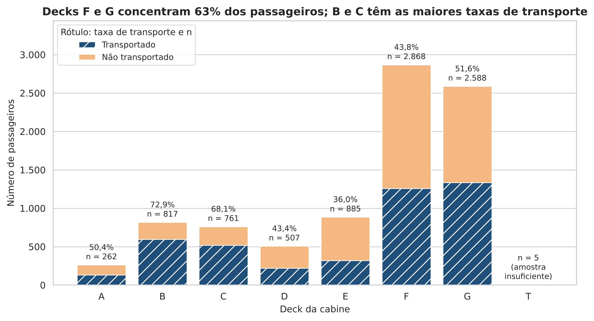

# 02 — Conclusões da Análise Descritiva e Visual

| | |
|---|---|
| **Ticket** | [KAN-18](https://megamatic.atlassian.net/browse/KAN-18) — Publicar conclusões descritivas em Markdown |
| **Responsável** | Helton Gomes Soares de Lima |
| **Revisora** | Luciana Almeida |
| **Consolida** | [KAN-14](https://megamatic.atlassian.net/browse/KAN-14) (categóricas) · [KAN-15](https://megamatic.atlassian.net/browse/KAN-15) (quantitativas) · [KAN-16](https://megamatic.atlassian.net/browse/KAN-16) (gráficos) · [KAN-17](https://megamatic.atlassian.net/browse/KAN-17) (valores extremos) |
| **Base** | `data/processed/spaceship_titanic_clean.csv` — 8.693 passageiros × 22 colunas, 0 valores ausentes |

**Notebooks de origem:**

- `notebooks/02_estatistica_descritiva.ipynb` — Parte I (KAN-14: Seções 1.1 a 1.4) e Parte II (KAN-16: figuras e Seção 2.1)
- `notebooks/04_kan15_resumos_quantitativos.ipynb` — Leituras A, B e C e interpretação (KAN-15)
- `notebooks/03_kan17_valores_extremos.ipynb` — Limites de Tukey e Seção 3 (KAN-17)

> **Escopo.** Este capítulo é **descritivo**: as diferenças relatadas são associações observadas, não relações de causa. A significância estatística é avaliada nas KAN-25 a 27, e o efeito conjunto das variáveis, na modelagem (KAN-33).

---

## 1. Perfil demográfico dos passageiros

**Origem e destino.** A maioria dos passageiros vem da **Terra (54,2%)**, seguida de **Europa (25,0%)** e **Marte (20,8%)**. O destino dominante é **TRAPPIST-1e (70,1%)**; 55 Cancri e recebe 20,7% e PSO J318.5-22, 9,2%. *(notebook 02, Seção 1.1)*

**Criossono e status VIP.** Pouco mais de um terço viajou em **criossono (36,1%)**. O status **VIP** é raro: **2,3% (199 passageiros)**. *(notebook 02, Seção 1.1)*

**Cabine.** Os dois lados do navio têm ocupação equilibrada (49,6% bombordo, 50,4% estibordo). Os decks **F (33,0%)** e **G (29,8%)** concentram quase dois terços dos passageiros. A ocupação dos decks segue a origem: **73% dos passageiros de Europa estão nos decks B e C**, enquanto praticamente todos os da Terra (99,98%) estão nos decks E, F e G; o deck G é ocupado exclusivamente por terráqueos. O deck **T** tem apenas **5 passageiros** e não sustenta conclusões. *(notebook 02, Seções 1.1 e 1.4; Figura 6)*

**Idade.** Média de **28,8 anos**, mediana de **27** e desvio-padrão de **14,4**. A distribuição é **aproximadamente simétrica** (assimetria de 0,43), concentrada entre 20 e 37 anos (Q1 e Q3), e a média é uma síntese adequada. **9,3% (806 passageiros)** são crianças de até 12 anos, incluindo 178 bebês com idade 0. *(notebook 04, Leitura A; Figura 3)*

**Grupos de viagem.** **55,3% viajam sozinhos**; a mediana do tamanho do grupo é 1 e a média, 2,04, puxada por grupos de 5 a 8 pessoas (cerca de 9% da base). *(notebook 04, Leitura A)*

**Desfecho.** O alvo é **balanceado**: **50,4% transportados** e 49,6% não transportados. *(notebook 02, Seção 1.1)*

---

## 2. Padrões de consumo e gastos a bordo

**A maioria não consome.** Em cada uma das cinco rubricas (RoomService, FoodCourt, ShoppingMall, Spa e VRDeck), **entre 62% e 66% dos passageiros gastaram zero**, e a mediana populacional é zero. Mediana zero significa que **a maioria não gastou**, não que "gastou pouco". *(notebook 04, Leitura A)*

**Médias enganam.** As médias populacionais (de US$ 170 em ShoppingMall a US$ 451 em FoodCourt) são puxadas por uma minoria de consumidores intensos: as assimetrias vão de 6,4 a 12,8 e os coeficientes de variação, de 298% a 379%. Por isso, **toda rubrica de gasto deve ser reportada com mediana e média juntas, mais o percentual de zeros**. *(notebook 04, Leitura A)*

**Ticket de quem consome.** Entre os que efetivamente usaram cada serviço, a média fica **2,6 a 2,9 vezes** acima da média populacional. FoodCourt tem o maior ticket médio (US$ 1.248) e Spa, a maior distância entre média e mediana (US$ 809 contra US$ 210). *(notebook 04, Leitura B)*

**Gasto total (`TotalSpend`).** Média de **US$ 1.447** e mediana de **US$ 717**, razão de aproximadamente 2. **41,9%** não gastaram nada; entre os 5.049 que gastaram, a média sobe para US$ 2.492 e a mediana, para US$ 1.192. *(notebook 04, Leituras A e B)*

**Co-consumo.** Quem usa um serviço tende a usar outros: as correlações de Spearman entre rubricas vão de 0,45 a 0,52 nos pares mais fortes (FoodCourt × VRDeck, FoodCourt × Spa, Spa × VRDeck, RoomService × ShoppingMall). A idade tem correlação fraca com o gasto total (ρ = 0,26). A análise formal de correlação é da KAN-30. *(notebook 04, correlação)*

**Valores extremos são clientes reais, não erros.** Pela regra de Tukey (1,5 × IQR), **21% a 22% dos passageiros** aparecem como extremos em cada rubrica, porque a massa de zeros comprime o IQR. Em `TotalSpend`, **938 passageiros (10,8%)** passam do limite de **US$ 3.610**. Esse grupo tem **3,7 vezes mais VIPs** que a base (8,4% contra 2,3%), **nenhum passageiro em criossono** e uma cauda contínua de valores. **Decisão do projeto: nenhum registro foi removido.** *(notebook 03, Seção 3)*

**Gasto por origem.** Passageiros de **Europa** concentram os maiores gastos (mediana de **US$ 1.914**, média de US$ 3.444), contra medianas de US$ 705 na Terra e US$ 950 em Marte. *(notebook 02, Figura 5)*

---

## 3. Relação exploratória entre atributos e `Transported`

Taxa global de transporte: **50,36%**. A tabela resume as categorias que mais se afastam dessa taxa (apenas categorias com pelo menos 30 passageiros). *(notebook 02, Seção 1.2)*

| Variável | Categoria | n | Taxa de transporte | Diferença |
|---|---|---:|---:|---:|
| CryoSleep | Em criossono | 3.135 | 81,5% | +31,1 p.p. |
| CabinDeck | B | 817 | 73,0% | +22,6 p.p. |
| CabinDeck | C | 761 | 68,1% | +17,7 p.p. |
| CryoSleep | Acordado | 5.558 | 32,8% | −17,5 p.p. |
| HomePlanet | Europa | 2.174 | 66,1% | +15,7 p.p. |
| CabinDeck | E | 885 | 36,0% | −14,3 p.p. |
| VIP | VIP | 199 | 38,2% | −12,2 p.p. |
| Destination | 55 Cancri e | 1.800 | 61,0% | +10,6 p.p. |

**Principais leituras:**

1. **Criossono é o sinal mais forte do dataset.** 81,5% dos passageiros em criossono foram transportados, contra 32,8% dos acordados. *(Figura 2)*
2. **Gasto e transporte andam em sentidos opostos.** Entre os transportados, a mediana do gasto total é zero e 65,5% não gastaram nada; entre os não transportados, só 18,0% têm gasto zero e a mediana é de US$ 907. Esse padrão se sobrepõe ao criossono, já que quem está em criossono não consome. *(Figura 4)*
3. **Origem e deck estão entrelaçados.** Europa (66,1%) e os decks B (73,0%) e C (68,1%) têm as maiores taxas, mas os passageiros de Europa ocupam justamente esses decks. Não é possível, apenas com a descrição, separar o efeito da origem do efeito do deck. *(Figuras 1 e 6)*
4. **Efeitos menores.** Estibordo tem taxa um pouco maior que bombordo (55,5% contra 45,1%), e VIPs foram menos transportados (38,2%), mas com uma amostra pequena (199 pessoas).

**Robustez à imputação.** A imputação pela moda (KAN-11) alterou as proporções das categorias em no máximo **0,64 p.p.** e as taxas de transporte em no máximo **0,77 p.p.**. As conclusões valem também para a base bruta. *(notebook 02, Seção 1.3)*

**Recomendações para as próximas etapas:**

- **KAN-25 (qui-quadrado):** o deck T viola o pressuposto de frequência esperada maior que 5 por célula. Agrupe-o com outro deck ou exclua-o apenas do teste.
- **KAN-26 e 27 (testes de `TotalSpend`):** a forte zero-inflação reforça o uso de testes robustos e a análise condicional aos que gastaram, como previsto na KAN-22.
- **KAN-33 (modelagem):** criossono, gasto, origem e deck devem entrar juntos no modelo, para estimar o efeito de cada um descontada a sobreposição com os demais.

---

## 4. Galeria de gráficos candidatos ao relatório

Figuras exportadas a 300 DPI em `report/figures/`. A seleção final e a numeração definitiva ficam para a KAN-38.

**Figura 1 — Taxa de transporte por planeta de origem.**
Europa tem a maior taxa de transporte (66,1%) e a Terra, a menor (42,3%); Marte fica perto da média geral (52,4%).

**Figura 2 — Taxa de transporte por criossono.**
A maior diferença do dataset: 81,5% dos passageiros em criossono foram transportados, contra 32,8% dos acordados.

**Figura 3 — Distribuição de idade.**
Distribuição aproximadamente simétrica, com média de 28,8 anos e mediana de 27, concentrada entre 20 e 37 anos; 9,3% são crianças de até 12 anos.

**Figura 4 — Gasto total a bordo por desfecho.**
Transportados têm mediana de gasto zero (65,5% sem consumo), contra mediana de US$ 907 entre os não transportados. Eixo em escala symlog; quartis e bigodes calculados na escala original, com a mesma regra da KAN-17; a linha tracejada marca o limite global de US$ 3.610.

**Figura 5 — Gasto total a bordo por planeta de origem.**
Europa concentra os maiores gastos (mediana de US$ 1.914), contra US$ 705 na Terra e US$ 950 em Marte. Os pontos acima do bigode são valores extremos mantidos na base.

**Figura 6 — Passageiros por deck da cabine e taxa de transporte.**
Os decks F e G concentram 63% dos passageiros; B (73,0%) e C (68,1%) têm as maiores taxas de transporte. O deck T (n = 5) está sinalizado como amostra insuficiente.

