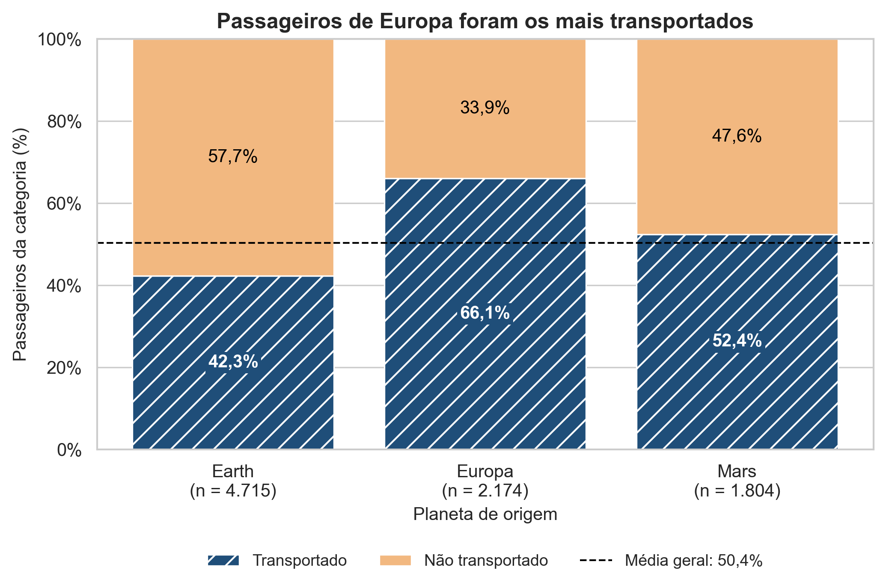
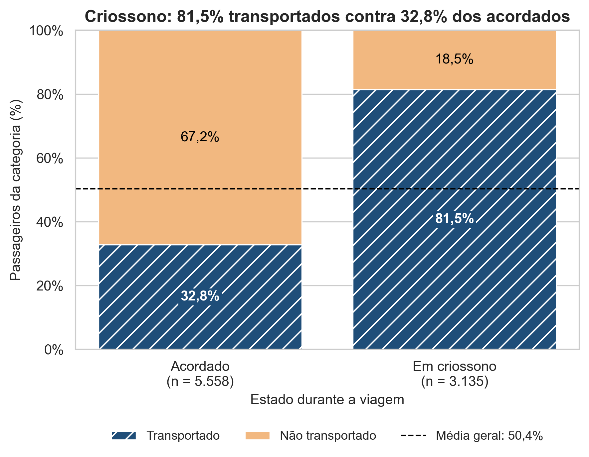
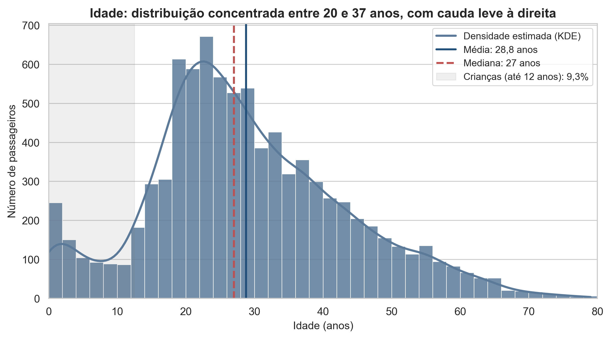
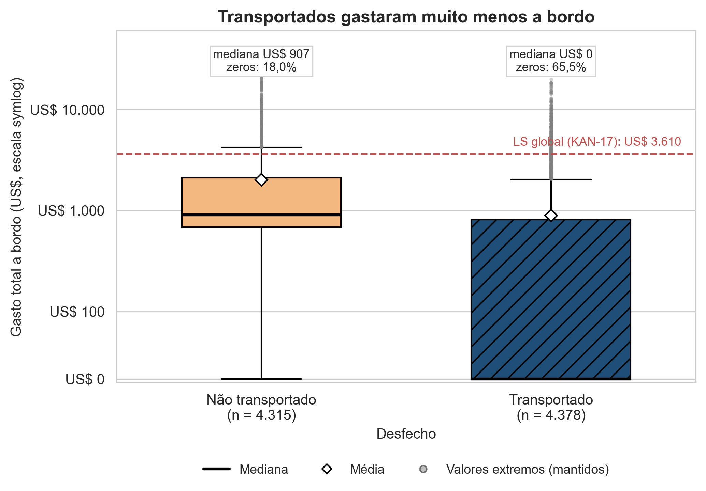
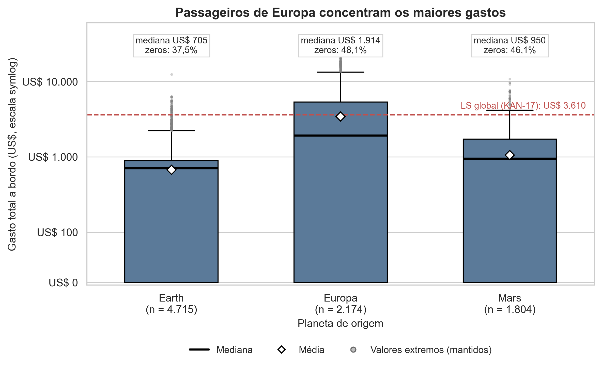
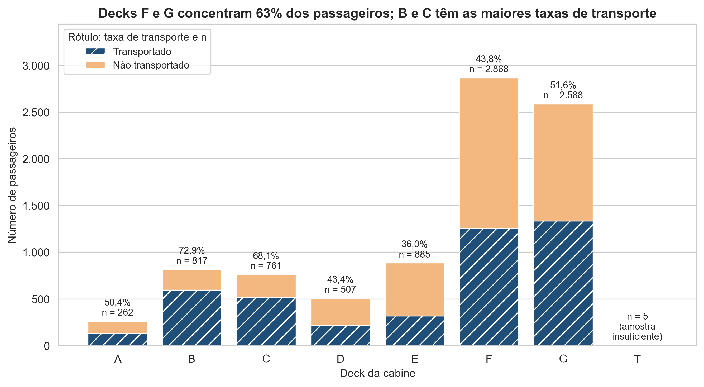

# 02 — Conclusões da Análise Descritiva e Visual (`KAN-18`)

- **Ticket Principal (Jira):** [KAN-18 — Publicar conclusões descritivas em Markdown](https://megamatic.atlassian.net/browse/KAN-18)
- **Tickets Consolidados da Trilha 1 (Análise Descritiva e Visual):**
  - [KAN-14 — Produzir resumos de variáveis categóricas](https://megamatic.atlassian.net/browse/KAN-14)
  - [KAN-15 — Produzir resumos de variáveis quantitativas](https://megamatic.atlassian.net/browse/KAN-15)
  - [KAN-16 — Exportar gráficos descritivos a 300 DPI](https://megamatic.atlassian.net/browse/KAN-16)
  - [KAN-17 — Definir critério de valores extremos](https://megamatic.atlassian.net/browse/KAN-17)
- **Notebook Base da Trilha:** [`notebooks/02_estatistica_descritiva.ipynb`](../../notebooks/02_estatistica_descritiva.ipynb)
- **Notebook Mestre Consolidado:** [`notebooks/00_projeto_final_estatistica.ipynb`](../../notebooks/00_projeto_final_estatistica.ipynb)
- **Base de Dados:** `data/processed/spaceship_titanic_clean.csv` — 8.693 passageiros × 22 colunas, 0 valores ausentes
- **Artefatos Visuais:** `report/figures/desc_01_homeplanet_transported.png` a `desc_06_cabindeck_transported.png` (PNG a 300 DPI)
- **Responsável Principal:** Helton Gomes Soares de Lima
- **Revisora Dedicada:** Luciana Almeida

> **Escopo e cautela interpretativa.** Este capítulo é **descritivo**. Todas as diferenças, proporções e comparações de gasto retratam **associações observadas** na base tratada, e não relações de causa. A existência e a magnitude estatística dessas associações são avaliadas nos testes de hipóteses (KAN-25 a KAN-27); a separação do efeito conjunto das variáveis fica para a modelagem (KAN-33). Como a base passou por imputação pela moda (KAN-11) em **2,1% a 2,5%** das variáveis categóricas, a Seção 3.2 apresenta a checagem de sensibilidade que sustenta as conclusões também para a base bruta.

---

## 1. Perfil Demográfico dos Passageiros

A base tratada reúne **8.693 passageiros** e **22 variáveis**, sem valores ausentes. A composição da amostra nas sete variáveis categóricas do estudo está na tabela abaixo; as proporções foram calculadas sobre o total de passageiros.

| Variável | Categoria | n | % |
| :--- | :--- | ---: | ---: |
| `HomePlanet` | Earth | 4.715 | 54,24 |
| | Europa | 2.174 | 25,01 |
| | Mars | 1.804 | 20,75 |
| `Destination` | TRAPPIST-1e | 6.097 | 70,14 |
| | 55 Cancri e | 1.800 | 20,71 |
| | PSO J318.5-22 | 796 | 9,16 |
| `CryoSleep` | Acordado | 5.558 | 63,94 |
| | Em criossono | 3.135 | 36,06 |
| `VIP` | Não VIP | 8.494 | 97,71 |
| | VIP | 199 | 2,29 |
| `CabinSide` | Bombordo (P) | 4.309 | 49,57 |
| | Estibordo (S) | 4.384 | 50,43 |
| `CabinDeck` | A | 262 | 3,01 |
| | B | 817 | 9,40 |
| | C | 761 | 8,75 |
| | D | 507 | 5,83 |
| | E | 885 | 10,18 |
| | F | 2.868 | 32,99 |
| | G | 2.588 | 29,77 |
| | T | 5 | 0,06 |
| `Transported` | Não transportado | 4.315 | 49,64 |
| | Transportado | 4.378 | 50,36 |

*(fonte: [notebook 02, Seção 1.1](../../notebooks/02_estatistica_descritiva.ipynb#11-tabelas-de-frequência))*

### 1.1. Origem e destino: uma rota concentrada

**Mais da metade dos passageiros embarcou na Terra (54,24%)**, seguida por Europa (25,01%) e Marte (20,75%). O destino é ainda mais concentrado: **70,14% iam para TRAPPIST-1e**, enquanto 55 Cancri e recebeu 20,71% e PSO J318.5-22, apenas 9,16% (796 pessoas).

Para a leitura do restante do capítulo, isso tem duas consequências práticas. A primeira é que a rota é pouco diversificada: qualquer conclusão sobre "destino" descreve, na prática, a comparação entre um grupo grande e dois grupos menores. A segunda é que **o destino menos frequente (796 passageiros) sustenta estimativas com margem de erro maior** do que os demais, o que recomenda cautela ao comparar taxas entre destinos.

### 1.2. Criossono e status VIP: um grupo grande e um grupo raro

Pouco mais de um terço da amostra viajou em **criossono (36,06%, 3.135 passageiros)** — grupo grande o suficiente para comparações estáveis. Já o status **VIP é raro (2,29%, 199 passageiros)**, e essa é a primeira limitação do capítulo: qualquer taxa calculada para VIPs se apoia em uma amostra pequena e deve ser lida como indicativa, não como estimativa precisa.

### 1.3. Cabine: lados equilibrados, decks desiguais e entrelaçados com a origem

Os dois lados do navio estão praticamente empatados (49,57% bombordo e 50,43% estibordo), o que faz do lado da cabine uma variável de comparação natural. A ocupação por deck, porém, é bastante desigual: **F (32,99%) e G (29,77%) concentram 62,76% dos passageiros**, enquanto o deck T registra apenas **5 passageiros (0,06%)**.

O ponto analítico mais importante é que **deck e planeta de origem não são informações independentes**:

- **72,6% dos passageiros de Europa** ocupam os decks B e C (37,58% e 35,00% dos europeus, respectivamente);
- **99,98% dos passageiros da Terra** ocupam os decks E, F e G;
- o **deck G é ocupado exclusivamente por terráqueos** (2.588 passageiros).

Na prática, comparar taxas por deck sem mencionar a origem compara, em boa parte, perfis de origem diferentes. Essa sobreposição é retomada na Seção 3.

### 1.4. Idade e composição dos grupos de viagem

A idade média é de **28,78 anos** (mediana de **27**, desvio-padrão de **14,35**), com assimetria de **0,43** — levemente à direita, mas com média e mediana próximas, o que indica que a média é uma síntese razoável. Metade dos passageiros tem entre **20 e 37 anos** (Q1 e Q3), e **9,3% (806 passageiros) são crianças de até 12 anos**, incluindo 178 bebês com idade 0.

A composição dos grupos reforça o perfil de viagem: **55,3% viajam sozinhos** (4.805 passageiros), a mediana do tamanho do grupo é 1 e a média, 2,04 — puxada por **8,9% da base em grupos de 5 a 8 pessoas** (774 passageiros). A distribuição é, portanto, fortemente concentrada em viajantes individuais, com uma cauda de grupos familiares.

*(fonte: [notebook 02, Figura 3](../../notebooks/02_estatistica_descritiva.ipynb))*

### 1.5. O desfecho é balanceado

O alvo `Transported` está praticamente dividido ao meio: **50,36% transportados (4.378)** e **49,64% não transportados (4.315)**. Isso tem duas implicações: (i) nenhuma classe é rara, o que favorece a modelagem e permite comparar grupos de tamanho semelhante; (ii) **um classificador ingênuo que sempre prevê a classe majoritária acertaria cerca de metade dos casos**, patamar que serve de referência mínima para os modelos das etapas seguintes.

---

## 2. Padrões de Consumo e Gastos a Bordo

O consumo a bordo é medido por cinco rubricas (`RoomService`, `FoodCourt`, `ShoppingMall`, `Spa`, `VRDeck`) e pelo gasto total (`TotalSpend`), todas em dólares. A característica dominante — e que condiciona toda a análise — é a **zero-inflação**: a maioria não consumiu em cada rubrica individual; considerando o conjunto dos serviços, 41,9% não consumiram nada e 58,1% tiveram algum gasto.

| Rubrica | % de zeros | Mediana (US$) | Média (US$) | Assimetria | Coef. de variação | Média entre consumidores (US$) | Média ÷ média geral |
| :--- | ---: | ---: | ---: | ---: | ---: | ---: | ---: |
| `RoomService` | 65,2 | 0 | 221,58 | 6,38 | 298,2% | 637,39 | 2,9× |
| `FoodCourt` | 63,8 | 0 | 451,40 | 7,17 | 353,6% | 1.248,10 | 2,8× |
| `ShoppingMall` | 65,8 | 0 | 169,95 | 12,77 | 351,8% | 496,93 | 2,9× |
| `Spa` | 62,3 | 0 | 305,45 | 7,72 | 368,5% | 809,28 | 2,6× |
| `VRDeck` | 64,4 | 0 | 299,09 | 7,90 | 379,2% | 840,05 | 2,8× |

### 2.1. A maioria não consome — e mediana zero não significa "gasto baixo"

Em cada rubrica, **entre 62,3% e 65,8% dos passageiros gastaram exatamente zero**, e a mediana é zero em todas as cinco. Uma mediana zero descreve a **maioria que não usou o serviço**; ela não diz que o consumo típico foi pequeno. Por isso, relatar apenas a mediana esconderia a parcela minoritária que efetivamente consome — e é justamente essa parcela que sustenta a receita de bordo.

### 2.2. As médias são puxadas por poucos consumidores

As médias populacionais variam de **US$ 169,95 (ShoppingMall) a US$ 451,40 (FoodCourt)**, mas com assimetrias entre **6,38 e 12,77** e coeficientes de variação entre **298,2% e 379,2%**. Ou seja, a média não representa o passageiro típico: ela é inflada por uma minoria de consumo intenso.

**Recomendação de reporte:** toda rubrica de gasto deve ser apresentada com **mediana, média e percentual de zeros em conjunto**. A mediana isolada esconde a receita concentrada; a média isolada sugere um consumo que a maioria não teve.

### 2.3. O ticket de quem efetivamente consome

Restringindo a análise a quem gastou algo em cada rubrica, a média fica **2,6 a 2,9 vezes acima da média populacional**. FoodCourt tem o maior ticket médio (**US$ 1.248,10**), e **Spa concentra a maior desigualdade entre consumidores**: média de **US$ 809,28** contra mediana de **US$ 210,00** — razão de 3,9, contra 2,1 em RoomService. Em outras palavras, dentro do grupo que usa o Spa há poucos passageiros com gastos muito acima do padrão dos demais.

### 2.4. Gasto total: 58,1% consomem, com média influenciada pelos grandes gastos

Em `TotalSpend`, a média é de **US$ 1.447,46** e a mediana, de **US$ 717,00** — razão de aproximadamente 2. **41,9% (3.644 passageiros) não gastaram nada**. Entre os **5.049 que gastaram**, a média sobe para **US$ 2.492,13** e a mediana, para **US$ 1.192,00**.

O indicador mais informativo, portanto, é a combinação de três números (41,9% / US$ 717 / US$ 1.447,46): eles descrevem, ao mesmo tempo, a parcela que não consome, o padrão de quem consome e o efeito dos grandes gastadores sobre a média.

### 2.5. Quem usa um serviço tende a usar outros

As correlações de Spearman entre rubricas são positivas e, nos pares mais fortes, moderadas: **FoodCourt × VRDeck (0,52)**, **FoodCourt × Spa (0,49)**, **Spa × VRDeck (0,45)** e **RoomService × ShoppingMall (0,45)**. Os demais pares ficam entre 0,18 e 0,26. A idade tem correlação fraca com o gasto total (**ρ = 0,26**).

A leitura prática é que o consumo a bordo se comporta menos como escolhas isoladas e mais como um **padrão de uso**: o passageiro que usa restaurante tende a usar também spa e realidade virtual. A quantificação formal dessas relações é objeto da KAN-30.

### 2.6. Valores extremos são clientes reais, não erros de registro

Pela regra de Tukey (1,5 × IQR), **21,0% a 21,9% dos passageiros** aparecem como extremos em cada rubrica. Esse percentual elevado não indica problema nos dados: decorre da massa de zeros, que comprime o intervalo interquartil e desloca o limite superior para perto de zero (por exemplo, US$ 57,50 em ShoppingMall).

Em `TotalSpend`, o limite superior é de **US$ 3.610,00** e **938 passageiros (10,8%)** ficam acima dele. Esse grupo tem **3,7 vezes mais VIPs que a base (8,4% contra 2,29%)** e **nenhum passageiro em criossono** — coerente com um perfil de consumo incompatível com a viagem em criossono. **Decisão do projeto: nenhum registro foi removido**; os extremos foram mantidos e tratados como parte legítima da distribuição.

### 2.7. Gasto por planeta de origem

| Planeta | n | % de zeros | Mediana (US$) | Média (US$) |
| :--- | ---: | ---: | ---: | ---: |
| Earth | 4.715 | 37,5 | 705,00 | 675,24 |
| Europa | 2.174 | 48,1 | 1.914,00 | 3.444,00 |
| Mars | 1.804 | 46,1 | 950,00 | 1.059,73 |

O caso de **Europa** é o mais informativo: é o grupo com **maior proporção de gasto zero (48,1%)** e, ao mesmo tempo, **maior mediana (US$ 1.914,00) e maior média (US$ 3.444,00)**. Isso só é possível porque, entre os europeus que consomem, os valores são bem mais altos. A Terra, com o menor percentual de zeros (37,5%), tem a menor mediana (US$ 705,00): consome com mais frequência, porém em valores menores.

*(fonte: [notebook 02, Figura 5](../../notebooks/02_estatistica_descritiva.ipynb))*

### 2.8. Gasto e desfecho: associação forte, mas sobreposta ao criossono

| `Transported` | n | % de zeros | Mediana (US$) | Média (US$) |
| :--- | ---: | ---: | ---: | ---: |
| Não transportado | 4.315 | 18,0 | 907,00 | 2.011,89 |
| Transportado | 4.378 | 65,5 | 0,00 | 891,15 |

Entre os transportados, **65,5% não gastaram nada** e a mediana é zero; entre os não transportados, apenas **18,0%** têm gasto zero e a mediana é de **US$ 907,00**. A diferença é grande, mas **não deve ser lida como efeito do consumo sobre o teletransporte**: quem estava em criossono não consome e, como se verá na Seção 3, foi transportado com muito mais frequência. Gasto e criossono são, portanto, informações sobrepostas — separá-las exige o modelo conjunto da KAN-33.

*(fonte: [notebook 02, Figura 4](../../notebooks/02_estatistica_descritiva.ipynb))*

---

## 3. Relação Exploratória entre Atributos e o Status de Transporte (`Transported`)

A taxa global de transporte é de **50,36%** e funciona como referência para todas as comparações. A tabela lista as categorias que mais se afastam dessa taxa, restritas àquelas com **pelo menos 30 passageiros** (o corte evita que categorias minúsculas dominem o ranking por ruído amostral).

| Variável | Categoria | n | Taxa de transporte | Diferença vs. 50,36% |
| :--- | :--- | ---: | ---: | ---: |
| `CryoSleep` | Em criossono | 3.135 | 81,47% | +31,10 p.p. |
| `CabinDeck` | B | 817 | 72,95% | +22,59 p.p. |
| `CabinDeck` | C | 761 | 68,07% | +17,71 p.p. |
| `CryoSleep` | Acordado | 5.558 | 32,82% | −17,54 p.p. |
| `HomePlanet` | Europa | 2.174 | 66,05% | +15,69 p.p. |
| `CabinDeck` | E | 885 | 36,05% | −14,32 p.p. |
| `VIP` | VIP | 199 | 38,19% | −12,17 p.p. |
| `Destination` | 55 Cancri e | 1.800 | 61,00% | +10,64 p.p. |

*(fonte: [notebook 02, Seção 1.2](../../notebooks/02_estatistica_descritiva.ipynb#12-tabelas-cruzadas-com-transported))*

### 3.1. Quatro leituras principais

**1. Criossono é o sinal mais forte do conjunto de dados.** **81,47%** dos passageiros em criossono foram transportados, contra **32,82%** dos acordados — diferença de **48,65 pontos percentuais** (31,10 acima e 17,54 abaixo da média). Nenhuma outra variável categórica isolada produz afastamento dessa ordem.

**2. Origem e deck estão entrelaçados e não podem ser lidos isoladamente.** Europa (66,05%) e os decks B (72,95%) e C (68,07%) apresentam as maiores taxas, mas **72,6% dos europeus ocupam justamente os decks B e C**. A descrição não permite separar o que é "origem" do que é "deck": os dois recortes identificam, em boa medida, o mesmo grupo de passageiros. O mesmo vale no sentido oposto: o deck E (36,05%) concentra passageiros da Terra, que têm a menor taxa (42,33%, −8,03 p.p.).

**3. Gasto e transporte caminham em sentidos opostos, mas por intermediação do criossono.** Como visto na Seção 2.8, transportados têm mediana de gasto zero e 65,5% de zeros. A explicação descritiva mais econômica é a sobreposição com o criossono, não uma relação direta entre consumo e desfecho.

**4. Efeitos menores e amostras pequenas exigem cautela.** Estibordo tem taxa um pouco maior que bombordo (**55,54% contra 45,09%**, diferença de 10,4 p.p.), e VIPs foram menos transportados (**38,19%**), mas o grupo VIP tem apenas 199 pessoas. O deck T, com 5 passageiros e taxa de 20,00%, **não deve ser interpretado**: o número é compatível com flutuação aleatória.

### 3.2. Robustez à imputação

A auditoria da imputação (KAN-11), centralizada na Seção 5.5.1 do notebook 01, encontrou alterações de proporção das categorias de **no máximo 0,64 p.p.** (TRAPPIST-1e, a moda de `Destination`) e as taxas de transporte por categoria em **no máximo 0,77 p.p.** (deck A). Essas diferenças pequenas apoiam a estabilidade dos padrões entre a base tratada e os registros observados da base bruta, sem demonstrar ausência de viés de imputação. O máximo de taxa considera categorias com pelo menos 30 passageiros; o deck T (n = 5) fica fora desse resumo.

*(fonte: [notebook 01, Seção 5.5.1](../../notebooks/01_preparacao_dados.ipynb#551-sensibilidade-das-categorias-e-taxas-de-transporte-à-imputação); resumo no notebook 02, Seção 1.3)*

### 3.3. Recomendações para as próximas etapas

- **KAN-25 (qui-quadrado):** o deck T viola o pressuposto de frequência esperada maior que 5 por célula. Recomenda-se **agrupá-lo a outro deck ou excluí-lo apenas do teste**, mantendo-o na descrição.
- **KAN-26 e KAN-27 (testes sobre `TotalSpend`):** a zero-inflação (41,9% de zeros, mediana zero nas rubricas) reforça o uso de **testes não paramétricos** e da análise condicional aos que gastaram, como previsto na KAN-22.
- **KAN-33 (modelagem):** criossono, gasto, origem e deck devem entrar **juntos** no modelo, para estimar o efeito de cada um descontada a sobreposição com os demais. Incluir apenas um deles produzirá estimativas contaminadas pelo outro.

---

## 4. Galeria de Gráficos Selecionados para o Relatório Final

Todas as figuras foram geradas no notebook 02 (Parte II) e exportadas a **300 DPI** em `report/figures/`. A seleção e a numeração definitiva (`fig_01_...` etc.) ficam para a KAN-38; aqui os arquivos mantêm o prefixo provisório `desc_`.

### Figura 1 — Taxa de transporte por planeta de origem

**O que mostra:** a proporção de transportados em cada planeta, com a taxa global (50,36%) marcada por linha tracejada. **Leitura:** Europa tem a maior taxa (**66,05%**) e a Terra, a menor (**42,33%**); Marte fica próxima da média (**52,44%**). Como a origem está entrelaçada com o deck (Seção 1.3), a figura descreve um perfil, não um efeito.

### Figura 2 — Taxa de transporte por criossono

**O que mostra:** a mesma lógica de barras 100% empilhadas, aplicada ao estado durante a viagem. **Leitura:** **81,47%** dos passageiros em criossono foram transportados, contra **32,82%** dos acordados — a maior diferença observada no conjunto de dados.

### Figura 3 — Distribuição de idade

**O que mostra:** histograma com intervalos de 2 anos e curva de densidade (KDE), com linhas para a média (28,8 anos) e a mediana (27) e faixa sombreada para crianças de até 12 anos. **Leitura:** distribuição aproximadamente simétrica, concentrada entre 20 e 37 anos, com **9,3% de crianças** e um pico visível em idade 0 (bebês).

### Figura 4 — Gasto total a bordo por desfecho

**O que mostra:** boxplots de `TotalSpend` para transportados e não transportados, com mediana, média (losango) e valores extremos; eixo em escala symlog para acomodar a massa de zeros. **Leitura:** entre os transportados, a mediana é **zero** e **65,5%** não gastaram nada; entre os não transportados, apenas **18,0%** têm gasto zero e a mediana é de **US$ 907,00**. A linha tracejada marca o limite global de US$ 3.610,00 (KAN-17).

### Figura 5 — Gasto total a bordo por planeta de origem

**O que mostra:** a mesma construção da Figura 4, agora comparando os três planetas. **Leitura:** Europa concentra os maiores gastos (**mediana de US$ 1.914,00** e média de US$ 3.444,00), contra **US$ 705,00** na Terra e **US$ 950,00** em Marte — apesar de ser o grupo com mais passageiros sem consumo (48,1%). Os pontos acima do bigode são valores extremos mantidos na base.

### Figura 6 — Passageiros por deck da cabine e taxa de transporte

**O que mostra:** barras empilhadas com o número absoluto de passageiros por deck e a taxa de transporte anotada em cada barra. **Leitura:** os decks **F e G concentram 62,76%** dos passageiros; **B (72,95%)** e **C (68,07%)** têm as maiores taxas. O deck T (n = 5) está sinalizado como **amostra insuficiente**.

---

## 5. Limitações e Cuidados Analíticos

1. **Associação não é causa.** Todas as comparações deste capítulo são descritivas. Criossono, origem, deck e gasto se sobrepõem; nenhuma leitura isolada identifica efeito próprio.
2. **Amostras pequenas.** VIP (199 passageiros) e deck T (5 passageiros) não sustentam estimativas estáveis. O corte de n ≥ 30 usado na Seção 3 é um critério de leitura, não um teste estatístico.
3. **Zero-inflação.** As rubricas de gasto têm mediana zero e 62,3% a 65,8% de zeros. Médias, coeficientes de variação e testes paramétricos são sensíveis a esse padrão.
4. **Imputação.** Cerca de 2,1% a 2,5% das variáveis categóricas foram imputadas pela moda (KAN-11). A checagem da Seção 3.2 mostra impacto máximo de 0,77 p.p. nas taxas, mas a base bruta continua sendo a referência para auditoria.
5. **Extremos mantidos.** Nenhum registro foi removido por critério de outlier; os extremos de gasto são clientes reais e devem permanecer no relatório e na modelagem.

---

## 6. Rastreabilidade: Links para as Células do Notebook `02_estatistica_descritiva.ipynb`

A tabela mapeia as **18 células** do notebook base [`notebooks/02_estatistica_descritiva.ipynb`](../../notebooks/02_estatistica_descritiva.ipynb) (Seção 2 do notebook consolidado), permitindo navegação direta para o código, as tabelas e as figuras citadas neste capítulo.

| Célula | ID (`.ipynb`) | Tipo | Ticket | Seção do notebook | Conteúdo e artefatos |
| :---: | :--- | :---: | :---: | :--- | :--- |
| **00** | `02761951` | `markdown` | `KAN-14`/`KAN-16` | Cabeçalho | Objetivo, notas de leitura e metadados do capítulo descritivo. |
| **01** | `d684e797` | `code` | `KAN-14` | Configuração | Carga da base tratada, contratos de integridade (8.693 × 22, zero ausentes), `ORDEM`/`ROTULOS`, formatação pt-BR e padrão visual. |
| **02** | `87a3db18` | `markdown` | `KAN-14` | 1.1 | Abertura da Parte I e apresentação das tabelas de frequência. |
| **03** | `6b742183` | `code` | `KAN-14` | 1.1 | `tabelas_freq` e `frequencias`: n e % das 7 variáveis categóricas. |
| **04** | `698c3c50` | `markdown` | `KAN-14` | 1.2 | Explicação das tabelas cruzadas e da coluna de diferença em p.p. |
| **05** | `2aae6bb8` | `code` | `KAN-14` | 1.2 | `tabelas_cruzadas`, ranking das categorias com n ≥ 30. |
| **06** | `9f22fe4c` | `markdown` | `KAN-14` | 1.3 | Referência à auditoria de sensibilidade centralizada no notebook 01. |
| **07** | `02ec76cf` | `markdown` | `KAN-14` | 1.3 | Resultado e cautelas da sensibilidade; os cálculos estão na Seção 5.5.1 do notebook 01. |
| **08** | `fdd72ae2` | `markdown` | `KAN-14` | 1.4 | Interpretação das tabelas: perfil, associações e cautelas. |
| **09** | `79e8a4d1` | `markdown` | `KAN-16` | Parte II | Abertura da Parte II e padrão visual das figuras. |
| **10** | `fda9d511` | `code` | `KAN-16` | 2.0 | Função `barras_100_empilhadas()` usada nas Figuras 1, 2 e 6. |
| **11** | `2598f142` | `code` | `KAN-16` | Figura 1 | `desc_01_homeplanet_transported.png`. |
| **12** | `dfdd436d` | `code` | `KAN-16` | Figura 2 | `desc_02_cryosleep_transported.png`. |
| **13** | `9e54921e` | `code` | `KAN-16` | Figura 3 | `desc_03_age_hist_kde.png`. |
| **14** | `f48f6c2b` | `code` | `KAN-16` | Figuras 4 e 5 | `desc_04_totalspend_box_transported.png` e `desc_05_totalspend_box_homeplanet.png`; tabelas `resumo_box` e `resumo_box_planeta`. |
| **15** | `7165bedf` | `code` | `KAN-16` | Figura 6 | `desc_06_cabindeck_transported.png`. |
| **16** | `28e205e6` | `code` | `KAN-16` | Conferência | Auditoria de DPI e de dimensões das figuras exportadas. |
| **17** | `8ffb7ebf` | `markdown` | `KAN-16` | 2.1 | Leitura sintética das seis figuras e observações metodológicas. |
