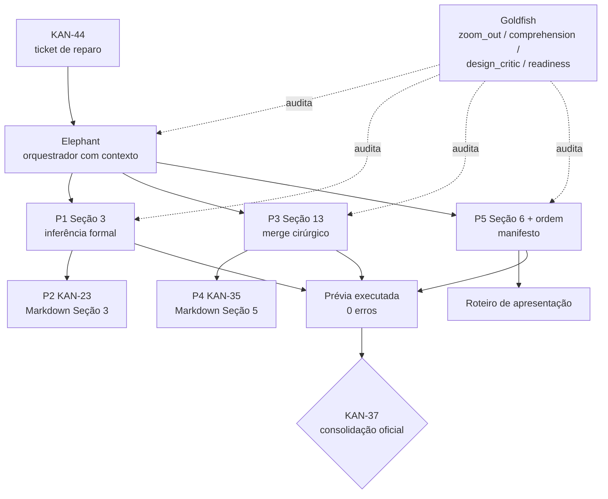

# Fechamento das Pendências de Conteúdo e Consolidação (KAN-44)

*   **Autor:** Gustavo Menezes Gonçalves
*   **Revisora:** Daniela Amaro
*   **Status:** Approved (decisões Q1–Q4 fechadas; revisão de decisão dispensada pelo solicitante)
*   **Data:** 2026-11-08
*   **Ticket:** [KAN-44](https://megamatic.atlassian.net/browse/KAN-44)
*   **Bloqueia:** [KAN-37](https://megamatic.atlassian.net/browse/KAN-37)

---

## Overview

Este documento descreve como reparar as lacunas encontradas na auditoria de 08/11/2026 e deixar o repositório pronto para a consolidação oficial do `KAN-37`. O trabalho cobre seis tickets analíticos marcados como concluídos sem artefato na `main` (KAN-20, KAN-21, KAN-22, KAN-23, KAN-34, KAN-35) e as lacunas estruturais da consolidação (Seção 6 ausente, ordem da Seção 2, validação frágil do manifesto e ausência de roteiro de apresentação).

O público é a revisora e o agente implementador. O documento precisa permitir que uma sessão nova execute o plano sem reconstruir o contexto da auditoria.

### Contexto e glossário

| Termo | Significado neste documento |
| :--- | :--- |
| **T3** | Trabalho final da disciplina, descrito em [`docs/T3 Projeto Final Estatística PosDL.docx`](../T3%20Projeto%20Final%20Estat%C3%ADstica%20PosDL.docx). Exige seis blocos: contexto, descritiva, probabilidade, testes, correlação/regressão e conclusões. Pesos: 30% qualidade técnica, 50% clareza, 20% organização. |
| **Manifesto** | `notebooks/consolidacao.json`. Define seções, tickets, notebooks e artefatos que o consolidador lê. |
| **Consolidador** | `src/consolidar_notebooks.py`. Gera o notebook mestre a partir do manifesto. |
| **Prévia** | Arquivo ignorado pelo Git, `notebooks/_previa_consolidado.ipynb`, usado para testar a consolidação antes do `KAN-37`. |
| **Notebook mestre** | `notebooks/00_projeto_final_estatistica.ipynb`. Proibido editar à mão. |
| **EGM** | Elephant-Goldfish Model. Orquestrador com contexto (Elephant) e revisores isolados (Goldfish). |
| **Goldfish** | Subagente novo, sem histórico, que audita um artefato e não edita arquivos. |
| **Merge cirúrgico** | Copiar apenas células específicas de outro arquivo, sem substituir o notebook inteiro. |
| **Execução limpa** | Rodar o notebook do zero, com saída 0 e nenhuma célula com `output_type == "error"`. |

### Pendências e tickets

| ID | Ticket(s) | Entrega | Estado atual |
| :--- | :--- | :--- | :--- |
| P1 | [KAN-20](https://megamatic.atlassian.net/browse/KAN-20), [KAN-21](https://megamatic.atlassian.net/browse/KAN-21), [KAN-22](https://megamatic.atlassian.net/browse/KAN-22) | `notebooks/03_probabilidade_distribuicoes.ipynb` | Inexistente |
| P2 | [KAN-23](https://megamatic.atlassian.net/browse/KAN-23) | `docs/conclusoes/03_probabilidade_distribuicoes.md` | Inexistente |
| P3 | [KAN-34](https://megamatic.atlassian.net/browse/KAN-34) | Seção 13 no notebook 05 + 2 figuras | Só na branch `feature/renatta-avaliacao-logistica` |
| P4 | [KAN-35](https://megamatic.atlassian.net/browse/KAN-35) | `docs/conclusoes/05_correlacao_regressoes.md` | Só em branches não integradas |
| P5 | [KAN-37](https://megamatic.atlassian.net/browse/KAN-37) | Seção 6, ordem da Seção 2, validação, roteiro | Parcial |

---

## The Problem

O board e o repositório divergem. Os tickets fechados não deixaram rastro verificável na `main`:

| Ticket | Estado no Jira | Evidência na `main` |
| :--- | :--- | :--- |
| KAN-20, KAN-21, KAN-22 | Concluído | `notebooks/03_probabilidade_distribuicoes.ipynb` não existe em nenhuma branch |
| KAN-23 | Concluído | `docs/conclusoes/03_probabilidade_distribuicoes.md` não existe |
| KAN-34 | Concluído | Seção 13 ausente do notebook 05 (68 células; termina na §12.4) |
| KAN-35 | Concluído | `docs/conclusoes/05_correlacao_regressoes.md` não existe na `main` |

A causa é rastreável. O notebook da KAN-19 declara na seção 4 que o QQ-plot e os testes formais ficam para a KAN-21, mas a KAN-21 não recebeu notebook próprio. Já os artefatos da KAN-34 e da KAN-35 existem apenas em branches remotas não integradas, porque os PRs #22 e #23 foram mergeados em `feature/renatta-avaliacao-logistica`, que a `main` absorveu antes desses commits. O blob do notebook 05 é idêntico em três branches (`ed6aa068ea8c`); a `main` tem outro blob (`739f89b63a5f`). O documento da KAN-35 está em `origin/docs/renatta-conclusoes-correlacao-regressoes` e em `origin/feature/renatta-avaliacao-logistica`.

O efeito prático é que o `KAN-37` não consegue gerar um notebook final íntegro. A prévia atual tem 191 células: 6 cabeçalhos (1 geral + 1 por seção), 76 de código e 109 de Markdown. O mestre versionado tem 96. O consolidador hoje reporta `faltantes`, `duplicadas` e `puladas_tag` iguais a zero apenas porque roda com `--permitir-faltantes`.

### O que já existe e não deve ser refeito

O notebook `05_kan19_variaveis_aleatorias_distribuicoes.ipynb` não é apenas teoria. Ele já contém:

*   célula 14: histograma de `Age` com Normal ajustada e tabela observado × previsto, exportando `fig_07_idade_normal_ajustada.png`;
*   célula 17: separação "quem gasta" × "quanto gasta", com Log-Normal nos positivos, exportando `fig_08_gasto_zero_e_log_normal.png`;
*   célula 22: tabela "Implicações para as próximas etapas (KAN-20 a KAN-22)".

A Seção 3 nova deve **citar e reconciliar** essa evidência, não reproduzi-la. Caso contrário o notebook consolidado mostrará a mesma análise duas vezes e duas tabelas de implicações concorrentes.

---

## Goals

1.  Criar a camada de inferência formal da Seção 3 em notebook próprio: QQ-plots, testes de aderência com tamanho de efeito e a tabela KAN-22 reconciliada com a Seção 4. Reutilizar as figuras e conclusões da KAN-19 em vez de recalculá-las.
2.  Publicar a conclusão em Markdown da Seção 3 (KAN-23), no formato das conclusões 01, 02 e 04.
3.  Reintegrar a Seção 13 da KAN-34 no notebook 05 por merge cirúrgico de 9 células, preservando as 68 atuais e os outputs.
4.  Recuperar `docs/conclusoes/05_correlacao_regressoes.md` (KAN-35) da branch de documentação.
5.  Adicionar a Seção 6 "Conclusões e Recomendações Práticas" como notebook e Markdown próprios.
6.  Reordenar a Seção 2 para que `02_estatistica_descritiva` (KAN-14 e KAN-16) venha antes de `04_kan15` e `03_kan17`, sem dividir o notebook 02.
7.  Fazer `--validar-mapa` falhar quando qualquer arquivo citado no manifesto não existir, sem afetar `--permitir-faltantes`.
8.  Publicar um roteiro de apresentação apoiado na Seção 6.
9.  Entregar todos os notebooks de origem com execução limpa, `seed(42)` e zero caminhos absolutos.

---

## Non-Goals

*   **Não** alterar `notebooks/00_projeto_final_estatistica.ipynb`. A regra de governança proíbe edição manual; ele continua sendo gerado apenas pelo consolidador.
*   **Não** executar a consolidação oficial (`--forcar --executar`). Isso pertence ao `KAN-37`.
*   **Não** cobrir `KAN-36` (apresentações da Reunião 2) nem `KAN-39` a `KAN-43` (relatório, revisão metodológica, validação numérica, PDF e pacote final).
*   **Não** refazer histogramas, ajustes Normal/Log-Normal e proporções de zero já produzidos pela KAN-19.
*   **Não** refazer as análises das Seções 1, 2, 4 e 5 já aprovadas. O reparo é de integração e cobertura.
*   **Não** dividir `notebooks/02_estatistica_descritiva.ipynb`. A célula 5 (KAN-14) define `tabelas_cruzadas`, consumido pelas células 10 a 15 (KAN-16). A divisão exigiria promover estado compartilhado e reescrever a tabela de rastreabilidade de 18 células em `docs/conclusoes/02_descritiva_visual.md`. O ganho é apenas cosmético.
*   **Não** alterar a base tratada nem remover outliers.
*   **Não** aplicar correção de multiplicidade confirmatória nos testes de aderência; eles são diagnósticos, não confirmatórios. O tamanho de efeito é o critério principal.

---

## Open Questions

Nenhuma questão aberta. As quatro questões levantadas na revisão foram decididas em 2026-11-08 e estão registradas abaixo. As decisões foram tomadas pelo solicitante, que dispensou a revisão de decisão pela revisora; a revisora permanece responsável pela revisão dos artefatos produzidos.

| ID | Questão | Decisão | Justificativa |
| :--- | :--- | :--- | :--- |
| **Q1** | QQ-plots dos cinco serviços ou apenas das duas variáveis principais? | Apenas `Age` e `log1p(TotalSpend)` com `TotalSpend > 0`. Os cinco serviços aparecem somente na tabela da KAN-22, com a justificativa hurdle. Acrescenta-se uma linha de sensibilidade `Age > 0` na tabela de aderência, sem figura. O teste é nomeado "Kolmogorov-Smirnov (Lilliefors)" no texto. | Serviços têm 62% a 66% de zeros; testar uma mistura hurdle contra uma lei contínua rejeita sempre e não informa. `Age` tem 178 zeros (2,0%) e 80 valores distintos: a linha de sensibilidade mostra que retirar os zeros **piora** a aderência (W cai de 0,980 para 0,975; D sobe de 0,076 para 0,085), ou seja, a rejeição vem da discretização e da concentração entre 20 e 40 anos, não do pico em zero. O T3 cita KS explicitamente, então o nome precisa aparecer. |
| **Q2** | As figuras novas entram no catálogo como `fig_09`–`fig_12`? | Não. O catálogo permanece com 8 figuras. Os QQ-plots são exibidos inline e **não** são gravados em `report/figures/`. | `docs/catalogo_figuras.md:97` fechou a seleção em 8 figuras no KAN-38 e reservou a inclusão de `fig_09` ou superior para a revisão cruzada do KAN-40. Acrescentar quatro figuras agora contradiz um ticket concluído e antecipa uma decisão que não é deste ticket. `fig_07` e `fig_08` já cobrem a evidência visual da Seção 3. |
| **Q3** | Quem é o dono da Seção 6? | O `KAN-44` cria `notebooks/06_conclusoes_recomendacoes.ipynb` e `docs/conclusoes/06_conclusoes_recomendacoes.md`. O `KAN-39` consome o Markdown e pode editar a prosa, mas não é dono do notebook. | O `KAN-37` precisa da Seção 6 no manifesto para consolidar. O `KAN-39` está "A fazer" e vem depois: se fosse o dono, o `KAN-37` geraria um mestre sem um bloco obrigatório do T3 e exigiria uma segunda consolidação, o que a governança proíbe. Os números necessários já existem nos documentos 02, 04 e 05. |
| **Q4** | A revisora aceita a exceção de governança de um ticket transversal? | Aceita, com três condições: (1) escopo fechado em KAN-20/21/22/23 e KAN-34/35 mais os artefatos novos; (2) posse histórica preservada nos tickets originais e registrada em `mapa_reparos`; (3) rastro no commit — artefatos restaurados usam `[KAN-34]` / `[KAN-35]`, artefatos novos usam `[KAN-44]`, e o corpo do commit traz `Refs: KAN-XX`. Após o merge, cada um dos seis tickets "Concluído" recebe um comentário com o link do commit que contém o artefato. | Sem as condições, o ticket vira precedente para qualquer edição. O repositório já usa esse padrão em commits de integração (`[KAN-38] Integrar PR #27`, `[KAN-34] Integrar…`). O comentário nos tickets ataca a causa-raiz: hoje o board afirma que o artefato existe sem que ele exista. |

---

## Critical User Journeys (CUJs)

### CUJ 1: Revisora valida o plano antes da implementação

*   **Given:** o `KAN-44` existe, está atribuído ao Gustavo e tem a Daniela como revisora; o design doc está em `docs/designs/pendencias-auditoria-consolidacao.md`.
*   **When:** a revisora lê as decisões D1 a D8 e responde Q1 a Q4 no ticket ou no PR.
*   **Then:** o documento passa a `Status: Approved` e a implementação começa. Nenhum notebook é alterado antes disso.

### CUJ 2: Desenvolvedor executa o reparo

*   **Given:** o plano aprovado e a branch `fix/gustavo-pendencias-auditoria` criada a partir da `main` atualizada (`git fetch origin && git switch -c ... origin/main`).
*   **When:** o orquestrador aplica os commits C1 a C8 na ordem da seção "Ordem de execução".
*   **Then:** cada notebook alterado executa do zero, sem caminho absoluto e com `seed(42)`. O `00_` permanece intocado.

### CUJ 3: Prévia consolidada fecha sem erro

*   **Given:** todas as pendências resolvidas e o manifesto atualizado.
*   **When:** o desenvolvedor roda a prévia com `--executar`.
*   **Then:** o comando termina com código 0, `faltantes = 0`, `duplicadas = 0`, `puladas_tag = 0` e nenhuma célula com `output_type == "error"`.

### CUJ 4: Consolidação oficial no KAN-37

*   **Given:** o `KAN-44` concluído e revisado.
*   **When:** o `KAN-37` roda `python src/consolidar_notebooks.py --forcar --executar`.
*   **Then:** o mestre é gerado de uma só vez, com as seis seções na ordem correta e sem intervenção manual.

### CUJ 5: Apresentação final

*   **Given:** a Seção 6 e o roteiro publicados.
*   **When:** a equipe prepara a apresentação.
*   **Then:** cada bloco do T3 tem mensagem, número de apoio, figura e origem declarada.

---

## Technical Plan (Architecture)

O trabalho segue o modelo Elephant-Goldfish. O orquestrador mantém o contexto e aplica as mudanças. Os Goldfish são subagentes novos, sem histórico, que auditam o plano e os artefatos. A separação impede que o agente que escreveu o código aprove o próprio código.



### Decisões de projeto

**D1 — Seção 3 como camada de inferência, em notebook novo.** O manifesto já aponta para `notebooks/03_probabilidade_distribuicoes.ipynb`. O notebook cobre o que a KAN-19 não cobriu: QQ-plots, testes formais com tamanho de efeito e a tabela de decisão da KAN-22. As evidências da KAN-19 são citadas por referência de célula, não recalculadas. Isso evita duplicação no consolidado e mantém o isolamento por ticket.

**D2 — Testes de aderência na amostra completa, com tamanho de efeito.** Não há subamostra. `Age` é testada com n = 8.693 e `log1p(TotalSpend)` com n = 5.049 (apenas `TotalSpend > 0`). Shapiro-Wilk reporta W; o `p` de Shapiro é impreciso acima de 5.000 observações e isso é declarado no texto. Lilliefors usa `pvalmethod="approx"`, porque o método padrão devolve o piso 0,001 para qualquer amostra grande. A decisão se apoia em W, D e leitura do QQ-plot, não no p. Nível de significância fixado em 0,05.

**D3 — Merge cirúrgico na KAN-34.** Copiar as células 68 a 76 (índice 0-based) da branch, com `copy.deepcopy` para preservar `outputs` e `metadata`; regenerar `id` para evitar colisão; validar com `nbformat.validate`; conferir que as células 0 a 67 não mudaram por hash; executar o notebook e verificar que os símbolos `logit_pipeline`, `LOGIT_FEATURES`, `POSITIVE_CLASS`, `baselines`, `metric_rows`, `confusion_tables`, `fmt_int` existem. Não usar `git checkout` do arquivo inteiro.

**D4 — Seção 6 com notebook e Markdown próprios.** O T3 exige o bloco final, que hoje não existe. O notebook `06_conclusoes_recomendacoes.ipynb` é a fonte analítica; o Markdown `06_conclusoes_recomendacoes.md` é o insumo do `KAN-39`. Para conciliar com o manifesto 1:1, o `KAN-44` é mapeado ao notebook 06 e um novo campo `mapa_reparos` lista os arquivos que ele repara.

**D5 — Sem split do notebook 02; apenas reordenação.** A ordem passa a `02_estatistica_descritiva` → `04_kan15` → `03_kan17`. Isso coloca o perfil categórico (KAN-14) antes dos resumos quantitativos e da documentação de outliers. As figuras (KAN-16) permanecem junto do perfil, o que é aceitável: elas descrevem o mesmo perfil. Evita-se duplicar `tabelas_cruzadas` e reescrever a tabela de 18 células do documento 02.

> **Nota de revisão (Luciana Almeida, 08/11/2026).** P5 e o critério de aceite 8 do ticket ainda pediam `KAN-14 → KAN-15 → KAN-17 → KAN-16`. A redação foi alinhada a esta decisão: o que se corrige é a ordem dos notebooks (`02` → `04_kan15` → `03_kan17`), não a ordem dos tickets, porque o notebook 02 concentra KAN-14 e KAN-16 e não será dividido. `notebooks/consolidacao.json` já estava nessa ordem e não foi alterado.

**D6 — Validação de manifesto separada da execução.** A checagem de existência vive em uma função própria, `validar_existencia_artefatos()`, chamada somente no ramo `--validar-mapa`. `--permitir-faltantes` continua afetando apenas a consolidação. A validação cobre `secao["notebooks"]`, `conclusao_markdown`, `artefatos_extras`, `mapa_outros_tickets[*]["notebook_origem"]` e `mapa_reparos`. O campo `mapa_outros_tickets[*]["alvo"]` **não** é checado, porque aponta para entregáveis futuros (atas, relatório, PDF) que ainda não existem por desenho — checá-lo faria a validação falhar nos tickets KAN-9 e KAN-36 a KAN-42. O intervalo de cobertura vira constantes explícitas `TICKET_MIN = 4` e `TICKET_MAX = 44`, sem derivação tautológica.

**D7 — Nenhuma figura nova no catálogo.** Os QQ-plots são exibidos inline e não são gravados em `report/figures/`. O catálogo do relatório permanece com as 8 figuras fechadas no KAN-38 (`docs/catalogo_figuras.md:97`), que reserva `fig_09` ou superior para a revisão cruzada do KAN-40. As figuras `kan30_*`, `kan31_*` e `kan34_*` são artefatos de notebook a 150 DPI e continuam fora do catálogo do relatório.

**D8 — Roteiro de apresentação como anexo da Seção 6.** O roteiro fica em `docs/apresentacao/roteiro_apresentacao.md`, com um bloco por seção do T3, tempo estimado, mensagem, número, figura e pergunta provável. Não substitui o `KAN-36`.

### Fluxo de dados

Nenhum notebook reparado cria pipeline de limpeza. Todos leem `data/processed/spaceship_titanic_clean.csv` por caminho relativo à raiz, no padrão já usado: `RAIZ = Path("..") if Path("../data/processed").exists() else Path(".")`.

---

## Alternatives Considered

### Alternative A: sobrescrever o notebook 05 com a versão da branch

*   **Pros:** um comando; traz a Seção 13 e as figuras de uma vez.
*   **Cons:** descarta 40 remoções e correções feitas na `main`; risco de regressão em §1 a §12.
*   **Reason for Rejection:** perda de trabalho já integrado.

### Alternative B: reabrir KAN-20, KAN-21, KAN-22, KAN-23, KAN-34 e KAN-35 individualmente

*   **Pros:** respeita literalmente o isolamento por ticket.
*   **Cons:** seis tickets para o mesmo bloco; revisão fragmentada; reabertura de cards concluídos confunde o histórico.
*   **Reason for Rejection:** custo de coordenação maior que o ganho. A mitigação é manter a posse nos tickets originais e registrar a exceção.

### Alternative C: dividir o notebook 02 em `02_kan14` e `02b_kan16`

*   **Pros:** ordem estritamente KAN-14 → KAN-15 → KAN-17 → KAN-16 e um ticket por arquivo.
*   **Cons:** `tabelas_cruzadas` nasce na célula 5 e é usado até a 15; a divisão exige promover estado, duplicar setup e reescrever a tabela de rastreabilidade de 18 células; dois arquivos para um capítulo de 18 células.
*   **Reason for Rejection:** o ganho é cosmético e o risco de `NameError` em execução limpa é alto.

### Alternative D: escrever a Seção 6 diretamente no notebook mestre

*   **Pros:** entrega imediata do bloco final.
*   **Cons:** viola a proibição de editar `00_`; a próxima consolidação sobrescreveria o conteúdo.
*   **Reason for Rejection:** conflito direto com a governança.

### Alternative E: extrair a Seção 6 do docx do T3

*   **Pros:** reaproveita texto existente.
*   **Cons:** o docx descreve o enunciado, não os resultados deste projeto.
*   **Reason for Rejection:** conteúdo não verificável.

---

## Non-Functional Requirements

*   **Reprodutibilidade:** todo notebook executa com *Restart & Run All*, `np.random.seed(42)` e caminhos relativos. Onde houver amostragem, `np.random.default_rng(42)`.
*   **Desempenho:** a prévia executada deve terminar em menos de 8 minutos na máquina de desenvolvimento. A meta anterior de 3 MB é inviável: a prévia atual tem 2,68 MB e as novas seções e figuras empurram o total para cerca de 3,5 MB. O limite passa a 4 MB, medido com `stat -c %s`.
*   **Rollback:** cada pendência é um commit `[KAN-44]` independente, exceto P3 e P4, que devem ser revertidos juntos porque o Markdown da KAN-35 referencia `[§13.x]`.
*   **Compatibilidade:** o consolidador mantém todos os argumentos atuais. A checagem de existência é aditiva e só roda em `--validar-mapa`.

### Riscos e Mitigações

| Risco | Probabilidade | Impacto | Mitigação |
| :--- | :--- | :--- | :--- |
| Merge da Seção 13 perder outputs ou duplicar `id` | Média | Alto | `deepcopy`, regeneração de `id`, `nbformat.validate`, hash das células 0–67, execução do notebook |
| Símbolos da §13 não existirem após refatoração da `main` | Baixa | Alto | Lista explícita de dependências verificada antes da execução |
| Testes de aderência virarem 14 linhas de "p < 0,001" | Alta | Médio | Reportar W e D como critério principal; QQ-plot no texto |
| `Age` discreta (80 valores, 178 zeros) distorcer o QQ-plot | Alta | Médio | Declarar a limitação e interpretar o pico em zero separadamente |
| `--validar-mapa` mais rígido quebrar fluxo | Baixa | Médio | Teste negativo isolado; `--permitir-faltantes` não é afetado |
| Conflito de governança por ticket transversal | Média | Médio | Exceção registrada em Q4 e no PR |
| Prévia passar de 4 MB | Média | Baixo | Medir com `stat`; se estourar, gerar prévia sem saídas para revisão |
| Figuras mudarem 1–2 px ao reexecutar | Alta | Baixo | Aceitar; conteúdo visual idêntico |

---

### Additional Resources

*   `notebooks/consolidacao.json`
*   `src/consolidar_notebooks.py`
*   `.agents/rules/governanca-notebooks-consolidacao.md`
*   `.agents/rules/objetivos-gerais-t3.md`
*   `docs/T3 Projeto Final Estatística PosDL.docx`
*   `docs/conclusoes/02_descritiva_visual.md` — modelo de formato
*   `docs/conclusoes/kan19_fichamento_distribuicoes.md` — base teórica da Seção 3
*   `docs/catalogo_figuras.md` — contrato de figuras
*   `origin/docs/renatta-conclusoes-correlacao-regressoes` — fonte do Markdown da KAN-35
*   `origin/feature/renatta-avaliacao-logistica` — fonte do notebook 05 com a Seção 13

### Future Improvements

*   **Job de validação em CI:** rodar `--validar-mapa` em pull request para impedir ticket "Concluído" sem artefato.
*   **Relatório de cobertura T3:** mapear automaticamente quais critérios do docx estão cobertos por quais células.
*   **Teste de regressão dos números:** usar o padrão de `tests/test_kan26.py` para afirmar p-valores e proporções da Seção 3.

---

## Detailed Implementation Plan

### Target Files to Create/Modify

#### 1. `notebooks/03_probabilidade_distribuicoes.ipynb` (Create)

*   **Escopo:** camada de inferência da Seção 3 (KAN-20, KAN-21, KAN-22). Não repete histogramas e ajustes da KAN-19.
*   **Estrutura de células (25 células previstas):**
    1.  Cabeçalho Markdown: seção T3, tickets, responsável, revisora, base, aviso observacional e link para o fichamento da KAN-19.
    2.  `## 1. Preparação reproduzível` — imports, `SEED = 42`, `RAIZ`, `np.random.seed(42)`, leitura da base, shape e nulos.
    3.  `## 2. O que a KAN-19 já estabeleceu` — tabela de referência às células 14, 17 e 22 do fichamento; nenhum recálculo.
    4.  `## 3. KAN-20 — Populações e momentos` — tabela por variável: população analisada, n, zeros, assimetria, curtose. `Age` = 8.693; `log1p(TotalSpend)` = 5.049; serviços = positivos.
    5.  `## 4. KAN-21 — QQ-plots` — `stats.probplot` para `Age` (Normal) e `log1p(TotalSpend)` (Normal), com parâmetros estimados declarados; leitura de cauda; menção ao pico em `Age = 0`.
    6.  `## 5. Testes formais` — Shapiro-Wilk na amostra completa (`Age` e `log1p(TotalSpend)`), reportando W e o aviso de precisão do p; Lilliefors (`pvalmethod="approx"`) reportando D e p; linha de sensibilidade `Age > 0` (sem figura); `alpha = 0,05`; tabela final.
    7.  `## 6. KAN-22 — Implicações para os testes` — tabela `variável → modelo → teste indicado → justificativa`, reconciliada com o que a Seção 4 efetivamente usou (t de Welch principal, Mann-Whitney complementar; Welch ANOVA principal, Kruskal-Wallis complementar).
    8.  `## 7. Síntese` — três a cinco mensagens acionáveis.
*   **Figuras:** nenhuma. Os QQ-plots são renderizados inline; o notebook não grava PNG em `report/figures/` (decisão Q2).
*   **Restrições:** nenhuma célula imprime caminho absoluto; toda saída numérica tem interpretação em Markdown.

#### 2. `docs/conclusoes/03_probabilidade_distribuicoes.md` (Create)

*   **Escopo:** conclusão Markdown da Seção 3 (KAN-23).
*   **Estrutura:** espelhar `docs/conclusoes/02_descritiva_visual.md` — cabeçalho com tickets, notebook, base, responsável, revisora; aviso observacional; seções numeradas com referências `[§x.y]`; tabela de decisões; limitações.
*   **Conteúdo obrigatório:** resultados de Shapiro e Lilliefors com W/D, o que muda na escolha dos testes, e a ressalva sobre `Age` discreta.

#### 3. `notebooks/05_correlacao_regressoes.ipynb` (Modify)

*   **Escopo:** reintegrar a Seção 13 (KAN-34).
*   **Procedimento reprodutível:**
    ```python
    import copy, hashlib, subprocess, nbformat
    main = nbformat.read("notebooks/05_correlacao_regressoes.ipynb", as_version=4)
    branch = nbformat.reads(
        subprocess.check_output([
            "git", "show",
            "origin/feature/renatta-avaliacao-logistica:notebooks/05_correlacao_regressoes.ipynb",
        ]).decode(), as_version=4)
    assert len(main.cells) == 68 and len(branch.cells) == 77
    before = [hashlib.sha256(c.source.encode()).hexdigest() for c in main.cells]
    novas = [copy.deepcopy(c) for c in branch.cells[68:77]]
    for i, c in enumerate(novas):
        c["id"] = f"kan34-{i:02d}"
    merged = nbformat.v4.new_notebook(cells=list(main.cells) + novas)
    assert [hashlib.sha256(c.source.encode()).hexdigest() for c in merged.cells[:68]] == before
    nbformat.validate(merged)
    nbformat.write(merged, "notebooks/05_correlacao_regressoes.ipynb")
    ```
*   **Figuras:** copiar `kan34_matriz_confusao.png` e `kan34_curvas_roc_pr.png` com `git show ... > report/figures/...`.
*   **Dependências a verificar antes de executar:** `logit_pipeline`, `LOGIT_FEATURES`, `POSITIVE_CLASS`, `baselines`, `metric_rows`, `confusion_tables`, `fmt_int`.
*   **Restrições:** não usar `git checkout` do arquivo completo; executar o notebook depois do merge.

#### 4. `docs/conclusoes/05_correlacao_regressoes.md` (Create a partir da branch)

*   **Escopo:** recuperar o documento de 117 linhas da KAN-35.
*   **Procedimento:** `git show origin/docs/renatta-conclusoes-correlacao-regressoes:docs/conclusoes/05_correlacao_regressoes.md > docs/conclusoes/05_correlacao_regressoes.md`.
*   **Ajustes:** revisar cabeçalho (responsável, revisor), confirmar que as referências `[§13.x]` existem após o merge e que os números citados batem com a execução.
*   **Restrições:** não reescrever o conteúdo analítico.

#### 5. `notebooks/06_conclusoes_recomendacoes.ipynb` (Create)

*   **Escopo:** Seção 6 do T3.
*   **Estrutura (10 células previstas):** cabeçalho; painel de evidências com números e origem; recomendações por perfil; limitações; próximos passos; uma célula de código que recomputa apenas as proporções de manchete.
*   **Números de manchete (com origem):**
    *   taxa de transporte 50,36% (4.378 de 8.693) — `docs/conclusoes/02_descritiva_visual.md`;
    *   taxa por `HomePlanet`: Europa 65,9%, Marte 52,3%, Terra 42,4% — `docs/conclusoes/04_testes_hipoteses_anova.md`;
    *   associação `HomePlanet` × `Transported`: χ² = 338,82; V de Cramér = 0,197 — idem;
    *   gasto médio por planeta: Europa US$ 3.444,00, Terra US$ 675,24 — idem;
    *   zeros em `TotalSpend`: 41,92% — base limpa;
    *   métricas do modelo logístico — `docs/conclusoes/05_correlacao_regressoes.md`.
*   **Restrições:** nenhuma análise nova; toda afirmação aponta a seção de origem.

#### 6. `docs/conclusoes/06_conclusoes_recomendacoes.md` (Create)

*   **Escopo:** resumo executivo de uma página, recomendações numeradas, limitações e próximo passo. Insumo do `KAN-39`.
*   **Restrição:** máximo de 700 palavras.

#### 7. `notebooks/consolidacao.json` (Modify)

*   **Mudanças:**
    *   `secao_2.notebooks = ["notebooks/02_estatistica_descritiva.ipynb", "notebooks/04_kan15_resumos_quantitativos.ipynb", "notebooks/03_kan17_valores_extremos.ipynb"]`.
    *   `secao_2.tickets` mantém `["KAN-14", "KAN-15", "KAN-16", "KAN-17"]`; a ordem de tickets não controla a ordem de notebooks.
    *   Novo `secao_6` com `id`, `titulo`, `objetivo_t3`, `tickets: ["KAN-44"]`, `ticket_conclusao: "KAN-44"`, `conclusao_markdown`, `notebooks`, `mapeamento_tickets` completo.
    *   `mapa_tickets_notebooks["KAN-44"] = "notebooks/06_conclusoes_recomendacoes.ipynb"`.
    *   Novo campo top-level `"mapa_reparos": {"KAN-44": ["notebooks/03_probabilidade_distribuicoes.ipynb", "docs/conclusoes/03_probabilidade_distribuicoes.md", "notebooks/05_correlacao_regressoes.ipynb", "docs/conclusoes/05_correlacao_regressoes.md"]}`.
*   **Restrições:** KAN-4 a KAN-44 cobertos; `secao_6` precisa de `mapeamento_tickets` para não escapar das checagens.

#### 8. `src/consolidar_notebooks.py` (Modify)

*   **Escopo:** validação de existência e leitura de `mapa_reparos`.
*   **Mudanças:**
    *   Nova função `validar_existencia_artefatos(manifesto, raiz)` que percorre `secao["notebooks"]`, `secao["conclusao_markdown"]`, `mapeamento_tickets[*]["artefatos_extras"]`, `mapa_outros_tickets[*]["alvo"]`, `mapa_outros_tickets[*]["notebook_origem"]` e `mapa_reparos`. Erro no formato `Arquivo inexistente para KAN-XX: caminho`.
    *   Chamada apenas no ramo `if args.validar_mapa`, depois de `validar_manifesto`.
    *   `TICKET_MIN = 4` e `TICKET_MAX = 44`; mensagem de erro atualizada para `KAN-4..KAN-44`.
    *   `consultar_ticket` imprime `Arquivos reparados` quando `mapa_reparos` tiver o ticket.
*   **Restrições:** `--permitir-faltantes` continua afetando somente `consolidar()`.

#### 9. `docs/guia_consolidacao.md` (Modify)

*   **Mudanças:** incluir a Seção 6 na tabela, os novos comandos com `.venv/bin/python`, a nota de que `--validar-mapa` verifica existência e o novo total de tickets (KAN-4 a KAN-44).

#### 10. `docs/catalogo_figuras.md` (No change)

*   **Escopo:** nenhuma alteração. A decisão Q2 mantém o catálogo fechado em 8 figuras e reserva a inclusão de `fig_09` ou superior para o KAN-40.

#### 11. `docs/apresentacao/roteiro_apresentacao.md` (Create)

*   **Escopo:** roteiro de 10 a 15 minutos, um bloco por seção do T3.
*   **Estrutura por bloco:** tempo, mensagem, número de apoio, figura, origem e pergunta provável.

#### 12. `docs/designs/pendencias-auditoria-consolidacao.md` (este arquivo)

*   **Mudanças:** `Status: Approved`, com Q1–Q4 convertidas em decisões registradas (2026-11-08). A revisora segue responsável pela revisão dos artefatos, não das decisões.

### Ordem de execução

| Commit | Conteúdo | Arquivos |
| :--- | :--- | :--- |
| C1 | Notebook da Seção 3 | `notebooks/03_probabilidade_distribuicoes.ipynb` |
| C2 | Conclusão da Seção 3 | `docs/conclusoes/03_probabilidade_distribuicoes.md` |
| C3 | Seção 13 da KAN-34 | notebook 05 + `report/figures/kan34_*.png` |
| C4 | Conclusão da Seção 5 | `docs/conclusoes/05_correlacao_regressoes.md` |
| C5 | Seção 6 | notebook 06 + `docs/conclusoes/06_conclusoes_recomendacoes.md` |
| C6 | Manifesto, validador e guia | `consolidacao.json`, `src/consolidar_notebooks.py`, `docs/guia_consolidacao.md` |
| C7 | Roteiro | `docs/apresentacao/roteiro_apresentacao.md` |

O antigo commit de catálogo de figuras foi cancelado pela decisão Q2. C3 e C4 devem ser revertidos juntos. C6 é o único commit que mexe no manifesto.

**Prefixo dos commits (decisão Q4):** C3 usa `[KAN-34]` e C4 usa `[KAN-35]`, por serem artefatos restaurados, com `Refs: KAN-44` no corpo. C1, C2, C5, C6 e C7 usam `[KAN-44]`, por serem artefatos novos. O branch e o PR ficam em `fix/gustavo-pendencias-auditoria`.

### Verification Plan

*   **Build/ambiente:** na raiz do projeto, `.venv/bin/python -c "import scipy, statsmodels, nbformat; print(scipy.__version__, statsmodels.__version__, nbformat.__version__)"` deve imprimir `1.18.1 0.15.0 4.5.x`.
*   **Manifesto:** `.venv/bin/python src/consolidar_notebooks.py --validar-mapa` deve sair com 0, imprimir `Seções analíticas T3 : 6` e `Tickets de notebook : 22`, sem linha `ERRO`.
*   **Teste negativo:** copiar o manifesto para `/tmp/kan44_negativo.json`, apontar `artefatos_extras` de KAN-10 para `docs/nao_existe.md` e rodar com `--manifesto /tmp/kan44_negativo.json --validar-mapa`; esperar código 1 e mensagem nomeando o arquivo.
*   **Consulta por ticket:** `--ticket KAN-20` deve mostrar `notebooks/03_probabilidade_distribuicoes.ipynb`; `--ticket KAN-44` deve mostrar `6. Conclusões e Recomendações Práticas` e a lista de reparos.
*   **Execução limpa:** `.venv/bin/jupyter nbconvert --to notebook --execute --inplace --ExecutePreprocessor.timeout=600 notebooks/<arquivo>.ipynb` para cada notebook alterado; esperar código 0 e nenhuma célula com `output_type == "error"`.
*   **Prévia executada:** `.venv/bin/python src/consolidar_notebooks.py --permitir-faltantes --forcar --executar --timeout 600 --saida notebooks/_previa_consolidado.ipynb`; esperar código 0, `faltantes = 0`, `duplicadas = 0`, `puladas_tag = 0` e nenhuma célula de erro.
*   **Contagem de células:** registrar o total e a composição por notebook. A conta esperada é `191 + 9 (Seção 13) + N3 + N6 + 1 (cabeçalho da Seção 6)`, com `N3` e `N6` registrados no commit.
*   **Sem figuras novas:** `git status --porcelain report/figures` não deve listar PNG novo; `git diff --name-only docs/catalogo_figuras.md` deve ser vazio (decisão Q2).
*   **Sensibilidade `Age > 0`:** a tabela de aderência do notebook 03 deve conter a linha de sensibilidade, e a conclusão da Seção 3 deve explicar que a rejeição da Normal decorre da discretização e da concentração entre 20 e 40 anos — retirar os zeros piora a aderência (decisão Q1).
*   **Caminhos absolutos:** `.venv/bin/python src/consolidar_notebooks.py ... 2>&1 | rg 'caminhos absolutos'` não deve retornar aviso; complementar com `rg -n '/home/|/Users/|/mnt/|/content/drive/|[A-Za-z]:[\\/]|file://' notebooks/*.ipynb`.
*   **Integridade do merge:** o script da seção 3 deste plano deve concluir sem `AssertionError`.
*   **Mestre intocado:** `git diff --name-only` não pode listar `notebooks/00_projeto_final_estatistica.ipynb`.
*   **Tamanho:** `stat -c %s notebooks/_previa_consolidado.ipynb` deve ficar abaixo de 4.194.304 bytes.
*   **E2E/consolidação oficial:** pertence ao `KAN-37`; o `KAN-44` comprova apenas a prévia.

---

*Drafted with EGM*
