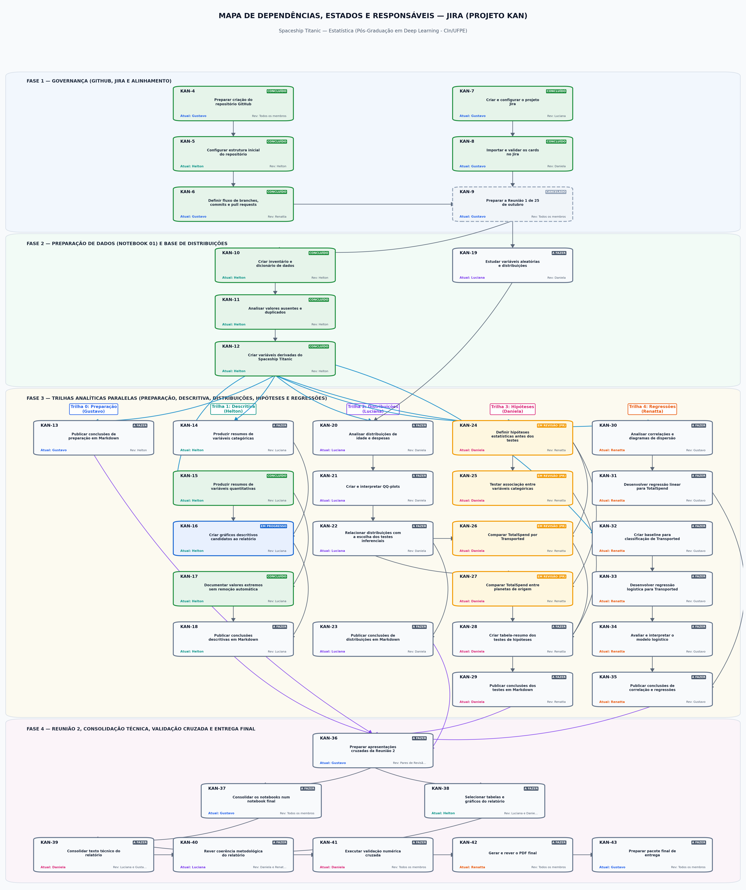

# Mapa de Dependências, Estados e Responsáveis — Jira (`KAN`)

Este documento consolida a arquitetura de dependências (DAG), o estado atual e a governança de responsáveis/revisores dos **40 tickets operacionais (`KAN-4` a `KAN-43`)** do projeto **Spaceship Titanic — Estatística (CIn/UFPE)**.

- **Painel Oficial no Jira:** [https://megamatic.atlassian.net/jira/software/projects/KAN/boards](https://megamatic.atlassian.net/jira/software/projects/KAN/boards)
- **Arquivos DSL Open-Source para Edição e Visualização:**
  - **Mermaid.js DSL (`.mmd`):** [`docs/mapa_dependencias_jira.mmd`](mapa_dependencias_jira.mmd) *(compatível nativamente com GitHub, Draw.io / diagrams.net, Lucidchart, Mermaid Live Editor, Notion e VS Code)*
  - **Graphviz DOT DSL (`.dot`):** [`docs/mapa_dependencias_jira.dot`](mapa_dependencias_jira.dot) *(compatível com Graphviz, Draw.io, Gephi e WebGraphviz)*
  - **Gerador Automatizado em Python:** [`src/gerar_mapa_dependencias.py`](../src/gerar_mapa_dependencias.py) *(regenera `.png`, `.mmd` e `.dot` com um único comando)*

---

## 1. Visualização Gráfica de Alta Resolução (PNG)



---

## 2. Diagrama Interativo em Mermaid.js (Renderização Nativa GitHub)

O bloco abaixo utiliza a DSL **Mermaid (`flowchart TD`)** e é renderizado interativamente pelo próprio GitHub.

```mermaid
flowchart TD
    %% =====================================================================
    %% MAPA DE DEPENDÊNCIAS, ESTADOS E RESPONSÁVEIS — JIRA (PROJETO KAN)
    %% Compatível com: GitHub Markdown, Draw.io (Arrange > Insert > Mermaid),
    %% Lucidchart, Mermaid Live Editor (https://mermaid.live) e VS Code.
    %% =====================================================================

    classDef concluido fill:#E6F4EA,stroke:#1E8E3E,stroke-width:2.5px,color:#0F172A;
    classDef revisao fill:#FEF7E0,stroke:#F29900,stroke-width:2.5px,color:#0F172A;
    classDef progresso fill:#E8F0FE,stroke:#1967D2,stroke-width:2.5px,color:#0F172A;
    classDef afazer fill:#F8FAFC,stroke:#64748B,stroke-width:1.8px,color:#0F172A;
    classDef cancelado fill:#F1F5F9,stroke:#94A3B8,stroke-width:1.8px,stroke-dasharray: 5 5,color:#64748B;

    subgraph FASE1["FASE 1 — Governança (GitHub, Jira e Alinhamento)"]
        KAN-4["<b>KAN-4</b> [CONCLUÍDO]<br/>Preparar criação do repositório GitHub<br/><i>Atual: Gustavo | Rev: Todos os membros</i>"]:::concluido
        KAN-5["<b>KAN-5</b> [CONCLUÍDO]<br/>Configurar estrutura inicial do repositório<br/><i>Atual: Helton | Rev: Helton</i>"]:::concluido
        KAN-6["<b>KAN-6</b> [CONCLUÍDO]<br/>Definir fluxo de branches, commits e pull requests<br/><i>Atual: Gustavo | Rev: Renatta</i>"]:::concluido
        KAN-7["<b>KAN-7</b> [CONCLUÍDO]<br/>Criar e configurar o projeto Jira<br/><i>Atual: Gustavo | Rev: Luciana</i>"]:::concluido
        KAN-8["<b>KAN-8</b> [CONCLUÍDO]<br/>Importar e validar os cards no Jira<br/><i>Atual: Gustavo | Rev: Daniela</i>"]:::concluido
        KAN-9["<b>KAN-9</b> [CANCELADO]<br/>Preparar a Reunião 1 de 25 de outubro<br/><i>Atual: Gustavo | Rev: Todos os membros</i>"]:::cancelado
    end

    subgraph FASE2["FASE 2 — Preparação de Dados (Notebook 01) e Base Teórica"]
        KAN-10["<b>KAN-10</b> [CONCLUÍDO]<br/>Criar inventário e dicionário de dados<br/><i>Atual: Helton | Rev: Helton</i>"]:::concluido
        KAN-11["<b>KAN-11</b> [CONCLUÍDO]<br/>Analisar valores ausentes e duplicados<br/><i>Atual: Helton | Rev: Helton</i>"]:::concluido
        KAN-12["<b>KAN-12</b> [CONCLUÍDO]<br/>Criar variáveis derivadas do Spaceship Titanic<br/><i>Atual: Helton | Rev: Helton</i>"]:::concluido
        KAN-19["<b>KAN-19</b> [A FAZER]<br/>Estudar variáveis aleatórias e distribuições<br/><i>Atual: Luciana | Rev: Daniela</i>"]:::afazer
    end

    subgraph FASE3["FASE 3 — Trilhas Analíticas Paralelas"]
        subgraph T0["Trilha 0: Preparação (Gustavo)"]
            KAN-13["<b>KAN-13</b> [A FAZER]<br/>Publicar conclusões de preparação em Markdown<br/><i>Atual: Gustavo | Rev: Helton</i>"]:::afazer
        end
        subgraph T1["Trilha 1: Estatística Descritiva (Helton)"]
            KAN-14["<b>KAN-14</b> [A FAZER]<br/>Produzir resumos de variáveis categóricas<br/><i>Atual: Helton | Rev: Luciana</i>"]:::afazer
            KAN-15["<b>KAN-15</b> [CONCLUÍDO]<br/>Produzir resumos de variáveis quantitativas<br/><i>Atual: Helton | Rev: Luciana</i>"]:::concluido
            KAN-16["<b>KAN-16</b> [EM PROGRESSO]<br/>Criar gráficos descritivos candidatos ao relatório<br/><i>Atual: Helton | Rev: Luciana</i>"]:::progresso
            KAN-17["<b>KAN-17</b> [CONCLUÍDO]<br/>Documentar valores extremos sem remoção automática<br/><i>Atual: Helton | Rev: Luciana</i>"]:::concluido
            KAN-18["<b>KAN-18</b> [A FAZER]<br/>Publicar conclusões descritivas em Markdown<br/><i>Atual: Helton | Rev: Luciana</i>"]:::afazer
        end
        subgraph T2["Trilha 2: Distribuições e QQ-Plots (Luciana)"]
            KAN-20["<b>KAN-20</b> [A FAZER]<br/>Analisar distribuições de idade e despesas<br/><i>Atual: Luciana | Rev: Daniela</i>"]:::afazer
            KAN-21["<b>KAN-21</b> [A FAZER]<br/>Criar e interpretar QQ-plots<br/><i>Atual: Luciana | Rev: Daniela</i>"]:::afazer
            KAN-22["<b>KAN-22</b> [A FAZER]<br/>Relacionar distribuições com a escolha dos testes inferenciais<br/><i>Atual: Luciana | Rev: Daniela</i>"]:::afazer
            KAN-23["<b>KAN-23</b> [A FAZER]<br/>Publicar conclusões de distribuições em Markdown<br/><i>Atual: Luciana | Rev: Daniela</i>"]:::afazer
        end
        subgraph T3["Trilha 3: Testes de Hipóteses (Daniela)"]
            KAN-24["<b>KAN-24</b> [EM REVISÃO]<br/>Definir hipóteses estatísticas antes dos testes<br/><i>Atual: Daniela | Rev: Renatta</i>"]:::revisao
            KAN-25["<b>KAN-25</b> [EM REVISÃO]<br/>Testar associação entre variáveis categóricas<br/><i>Atual: Daniela | Rev: Renatta</i>"]:::revisao
            KAN-26["<b>KAN-26</b> [EM REVISÃO]<br/>Comparar TotalSpend por Transported<br/><i>Atual: Daniela | Rev: Renatta</i>"]:::revisao
            KAN-27["<b>KAN-27</b> [EM REVISÃO]<br/>Comparar TotalSpend entre planetas de origem<br/><i>Atual: Daniela | Rev: Renatta</i>"]:::revisao
            KAN-28["<b>KAN-28</b> [A FAZER]<br/>Criar tabela-resumo dos testes de hipóteses<br/><i>Atual: Daniela | Rev: Renatta</i>"]:::afazer
            KAN-29["<b>KAN-29</b> [A FAZER]<br/>Publicar conclusões dos testes em Markdown<br/><i>Atual: Daniela | Rev: Renatta</i>"]:::afazer
        end
        subgraph T4["Trilha 4: Correlação e Regressões (Renatta)"]
            KAN-30["<b>KAN-30</b> [A FAZER]<br/>Analisar correlações e diagramas de dispersão<br/><i>Atual: Renatta | Rev: Gustavo</i>"]:::afazer
            KAN-31["<b>KAN-31</b> [A FAZER]<br/>Desenvolver regressão linear para TotalSpend<br/><i>Atual: Renatta | Rev: Gustavo</i>"]:::afazer
            KAN-32["<b>KAN-32</b> [A FAZER]<br/>Criar baseline para classificação de Transported<br/><i>Atual: Renatta | Rev: Gustavo</i>"]:::afazer
            KAN-33["<b>KAN-33</b> [A FAZER]<br/>Desenvolver regressão logística para Transported<br/><i>Atual: Renatta | Rev: Gustavo</i>"]:::afazer
            KAN-34["<b>KAN-34</b> [A FAZER]<br/>Avaliar e interpretar o modelo logístico<br/><i>Atual: Renatta | Rev: Gustavo</i>"]:::afazer
            KAN-35["<b>KAN-35</b> [A FAZER]<br/>Publicar conclusões de correlação e regressões<br/><i>Atual: Renatta | Rev: Gustavo</i>"]:::afazer
        end
    end

    subgraph FASE4["FASE 4 — Consolidação, Validação Cruzada e Entrega Final"]
        KAN-36["<b>KAN-36</b> [A FAZER]<br/>Preparar apresentações cruzadas da Reunião 2<br/><i>Atual: Gustavo | Rev: Pares de Revisão Cruzada</i>"]:::afazer
        KAN-37["<b>KAN-37</b> [A FAZER]<br/>Consolidar os notebooks num notebook final<br/><i>Atual: Gustavo | Rev: Todos os membros</i>"]:::afazer
        KAN-38["<b>KAN-38</b> [A FAZER]<br/>Selecionar tabelas e gráficos do relatório<br/><i>Atual: Helton | Rev: Luciana e Daniela</i>"]:::afazer
        KAN-39["<b>KAN-39</b> [A FAZER]<br/>Consolidar texto técnico do relatório<br/><i>Atual: Daniela | Rev: Luciana e Gustavo</i>"]:::afazer
        KAN-40["<b>KAN-40</b> [A FAZER]<br/>Rever coerência metodológica do relatório<br/><i>Atual: Luciana | Rev: Daniela e Renatta</i>"]:::afazer
        KAN-41["<b>KAN-41</b> [A FAZER]<br/>Executar validação numérica cruzada<br/><i>Atual: Daniela | Rev: Todos os membros</i>"]:::afazer
        KAN-42["<b>KAN-42</b> [A FAZER]<br/>Gerar e rever o PDF final<br/><i>Atual: Renatta | Rev: Todos os membros</i>"]:::afazer
        KAN-43["<b>KAN-43</b> [A FAZER]<br/>Preparar pacote final de entrega<br/><i>Atual: Gustavo | Rev: Todos os membros</i>"]:::afazer
    end

    %% Arestas de Dependência (Origem --> Destino)
    KAN-4 --> KAN-5
    KAN-5 --> KAN-6
    KAN-7 --> KAN-8
    KAN-6 --> KAN-9
    KAN-8 --> KAN-9
    KAN-9 --> KAN-10
    KAN-10 --> KAN-11
    KAN-11 --> KAN-12
    KAN-12 --> KAN-13
    KAN-12 --> KAN-14
    KAN-12 --> KAN-15
    KAN-14 --> KAN-16
    KAN-15 --> KAN-16
    KAN-15 --> KAN-17
    KAN-16 --> KAN-18
    KAN-17 --> KAN-18
    KAN-9 --> KAN-19
    KAN-12 --> KAN-20
    KAN-19 --> KAN-20
    KAN-20 --> KAN-21
    KAN-21 --> KAN-22
    KAN-22 --> KAN-23
    KAN-12 --> KAN-24
    KAN-24 --> KAN-25
    KAN-22 --> KAN-26
    KAN-24 --> KAN-26
    KAN-22 --> KAN-27
    KAN-24 --> KAN-27
    KAN-25 --> KAN-28
    KAN-26 --> KAN-28
    KAN-27 --> KAN-28
    KAN-28 --> KAN-29
    KAN-12 --> KAN-30
    KAN-30 --> KAN-31
    KAN-12 --> KAN-32
    KAN-32 --> KAN-33
    KAN-33 --> KAN-34
    KAN-34 --> KAN-35
    KAN-31 --> KAN-35
    KAN-13 --> KAN-36
    KAN-18 --> KAN-36
    KAN-23 --> KAN-36
    KAN-29 --> KAN-36
    KAN-35 --> KAN-36
    KAN-36 --> KAN-37
    KAN-36 --> KAN-38
    KAN-37 --> KAN-39
    KAN-38 --> KAN-39
    KAN-39 --> KAN-40
    KAN-40 --> KAN-41
    KAN-41 --> KAN-42
    KAN-42 --> KAN-43
```



---

## 3. Como Atualizar ou Importar em Ferramentas Visuais (Draw.io, Lucidchart, Mermaid)

### Opção A — Atualizar via Script Python (Recomendado)
1. Edite o estado (`status`) ou responsável (`assignee`) do ticket no dicionário `TICKETS_JIRA` dentro de [`src/gerar_mapa_dependencias.py`](../src/gerar_mapa_dependencias.py).
2. Execute na raiz do repositório:
   ```bash
   python src/gerar_mapa_dependencias.py
   ```
   O script atualizará automaticamente a imagem `docs/mapa_dependencias_jira.png` e os arquivos DSL `docs/mapa_dependencias_jira.mmd` e `docs/mapa_dependencias_jira.dot`.

### Opção B — Importar no Draw.io (`app.diagrams.net`)
1. Abra o [Draw.io (diagrams.net)](https://app.diagrams.net/).
2. No menu superior, clique em **Arrange (Organizar) $\rightarrow$ Insert (Inserir) $\rightarrow$ Advanced (Avançado) $\rightarrow$ Mermaid...** (ou **From Text / DOT**).
3. Cole o conteúdo de [`docs/mapa_dependencias_jira.mmd`](mapa_dependencias_jira.mmd) (para Mermaid) ou [`docs/mapa_dependencias_jira.dot`](mapa_dependencias_jira.dot) (para Graphviz DOT) e clique em **Insert**. Todos os blocos e conectores serão convertidos em objetos editáveis!

### Opção C — Editar no Mermaid Live Editor ou Lucidchart
- **Mermaid Live Editor:** Acesse [https://mermaid.live](https://mermaid.live) e cole o conteúdo de [`docs/mapa_dependencias_jira.mmd`](mapa_dependencias_jira.mmd). Para mudar a cor/estado de um ticket, basta trocar o sufixo da classe no final do nó:
  - `:::concluido` (Verde)
  - `:::revisao` (Laranja / Em Revisão)
  - `:::progresso` (Azul / Em Progresso)
  - `:::afazer` (Cinza / A Fazer)
  - `:::cancelado` (Tracejado / Cancelado)
- **Lucidchart:** Clique em **Insert $\rightarrow$ Mermaid** e cole o conteúdo de [`docs/mapa_dependencias_jira.mmd`](mapa_dependencias_jira.mmd).

---

## 4. Tabela Completa de Rastreabilidade dos Tickets (`KAN-4` a `KAN-43`)

| Ticket | Resumo da Tarefa | Estado Atual | Assignee Atual (Jira) | Responsável Principal | Revisor Dedicado | Dependências Diretas |
| :--- | :--- | :--- | :--- | :--- | :--- | :--- |
| [`KAN-4`](https://megamatic.atlassian.net/browse/KAN-4) | Preparar criação do repositório GitHub | **Concluído** | Gustavo | Gustavo | Todos os membros (Confirmação de Acesso) | — |
| [`KAN-5`](https://megamatic.atlassian.net/browse/KAN-5) | Configurar estrutura inicial do repositório | **Concluído** | Helton | Gustavo | Helton | `KAN-4` |
| [`KAN-6`](https://megamatic.atlassian.net/browse/KAN-6) | Definir fluxo de branches, commits e pull requests | **Concluído** | Gustavo | Gustavo | Renatta | `KAN-5` |
| [`KAN-7`](https://megamatic.atlassian.net/browse/KAN-7) | Criar e configurar o projeto Jira | **Concluído** | Gustavo | Gustavo | Luciana | — |
| [`KAN-8`](https://megamatic.atlassian.net/browse/KAN-8) | Importar e validar os cards no Jira | **Concluído** | Gustavo | Gustavo | Daniela | `KAN-7` |
| [`KAN-9`](https://megamatic.atlassian.net/browse/KAN-9) | Preparar a Reunião 1 de 25 de outubro | **Cancelado** | Gustavo | Gustavo | Todos os membros | `KAN-6`, `KAN-8` |
| [`KAN-10`](https://megamatic.atlassian.net/browse/KAN-10) | Criar inventário e dicionário de dados | **Concluído** | Helton | Gustavo | Helton | `KAN-9` |
| [`KAN-11`](https://megamatic.atlassian.net/browse/KAN-11) | Analisar valores ausentes e duplicados | **Concluído** | Helton | Gustavo | Helton | `KAN-10` |
| [`KAN-12`](https://megamatic.atlassian.net/browse/KAN-12) | Criar variáveis derivadas do Spaceship Titanic | **Concluído** | Helton | Gustavo | Helton | `KAN-11` |
| [`KAN-13`](https://megamatic.atlassian.net/browse/KAN-13) | Publicar conclusões de preparação em Markdown | **A fazer** | Gustavo | Gustavo | Helton | `KAN-12` |
| [`KAN-14`](https://megamatic.atlassian.net/browse/KAN-14) | Produzir resumos de variáveis categóricas | **A fazer** | Helton | Helton | Luciana | `KAN-12` |
| [`KAN-15`](https://megamatic.atlassian.net/browse/KAN-15) | Produzir resumos de variáveis quantitativas | **Concluído** | Helton | Helton | Luciana | `KAN-12` |
| [`KAN-16`](https://megamatic.atlassian.net/browse/KAN-16) | Criar gráficos descritivos candidatos ao relatório | **Em Progresso** | Helton | Helton | Luciana | `KAN-14`, `KAN-15` |
| [`KAN-17`](https://megamatic.atlassian.net/browse/KAN-17) | Documentar valores extremos sem remoção automática | **Concluído** | Helton | Helton | Luciana | `KAN-15` |
| [`KAN-18`](https://megamatic.atlassian.net/browse/KAN-18) | Publicar conclusões descritivas em Markdown | **A fazer** | Helton | Helton | Luciana | `KAN-16`, `KAN-17` |
| [`KAN-19`](https://megamatic.atlassian.net/browse/KAN-19) | Estudar variáveis aleatórias e distribuições | **A fazer** | Luciana | Luciana | Daniela | `KAN-9` |
| [`KAN-20`](https://megamatic.atlassian.net/browse/KAN-20) | Analisar distribuições de idade e despesas | **A fazer** | Luciana | Luciana | Daniela | `KAN-12`, `KAN-19` |
| [`KAN-21`](https://megamatic.atlassian.net/browse/KAN-21) | Criar e interpretar QQ-plots | **A fazer** | Luciana | Luciana | Daniela | `KAN-20` |
| [`KAN-22`](https://megamatic.atlassian.net/browse/KAN-22) | Relacionar distribuições com a escolha dos testes inferenciais | **A fazer** | Luciana | Luciana | Daniela | `KAN-21` |
| [`KAN-23`](https://megamatic.atlassian.net/browse/KAN-23) | Publicar conclusões de distribuições em Markdown | **A fazer** | Luciana | Luciana | Daniela | `KAN-22` |
| [`KAN-24`](https://megamatic.atlassian.net/browse/KAN-24) | Definir hipóteses estatísticas antes dos testes | **In Review** | Daniela | Daniela | Renatta | `KAN-12` |
| [`KAN-25`](https://megamatic.atlassian.net/browse/KAN-25) | Testar associação entre variáveis categóricas | **In Review** | Daniela | Daniela | Renatta | `KAN-24` |
| [`KAN-26`](https://megamatic.atlassian.net/browse/KAN-26) | Comparar TotalSpend por Transported | **In Review** | Daniela | Daniela | Renatta | `KAN-22`, `KAN-24` |
| [`KAN-27`](https://megamatic.atlassian.net/browse/KAN-27) | Comparar TotalSpend entre planetas de origem | **In Review** | Daniela | Daniela | Renatta | `KAN-22`, `KAN-24` |
| [`KAN-28`](https://megamatic.atlassian.net/browse/KAN-28) | Criar tabela-resumo dos testes de hipóteses | **A fazer** | Daniela | Daniela | Renatta | `KAN-25`, `KAN-26`, `KAN-27` |
| [`KAN-29`](https://megamatic.atlassian.net/browse/KAN-29) | Publicar conclusões dos testes em Markdown | **A fazer** | Daniela | Daniela | Renatta | `KAN-28` |
| [`KAN-30`](https://megamatic.atlassian.net/browse/KAN-30) | Analisar correlações e diagramas de dispersão | **A fazer** | Renatta | Renatta | Gustavo | `KAN-12` |
| [`KAN-31`](https://megamatic.atlassian.net/browse/KAN-31) | Desenvolver regressão linear para TotalSpend | **A fazer** | Renatta | Renatta | Gustavo | `KAN-30` |
| [`KAN-32`](https://megamatic.atlassian.net/browse/KAN-32) | Criar baseline para classificação de Transported | **A fazer** | Renatta | Renatta | Gustavo | `KAN-12` |
| [`KAN-33`](https://megamatic.atlassian.net/browse/KAN-33) | Desenvolver regressão logística para Transported | **A fazer** | Renatta | Renatta | Gustavo | `KAN-32` |
| [`KAN-34`](https://megamatic.atlassian.net/browse/KAN-34) | Avaliar e interpretar o modelo logístico | **A fazer** | Renatta | Renatta | Gustavo | `KAN-33` |
| [`KAN-35`](https://megamatic.atlassian.net/browse/KAN-35) | Publicar conclusões de correlação e regressões | **A fazer** | Renatta | Renatta | Gustavo | `KAN-34`, `KAN-31` |
| [`KAN-36`](https://megamatic.atlassian.net/browse/KAN-36) | Preparar apresentações cruzadas da Reunião 2 | **A fazer** | Gustavo | Todos (Coordenação: Gustavo) | Pares de Revisão Cruzada | `KAN-13`, `KAN-18`, `KAN-23`, `KAN-29`, `KAN-35` |
| [`KAN-37`](https://megamatic.atlassian.net/browse/KAN-37) | Consolidar os notebooks num notebook final | **A fazer** | Gustavo | Gustavo | Todos os membros | `KAN-36` |
| [`KAN-38`](https://megamatic.atlassian.net/browse/KAN-38) | Selecionar tabelas e gráficos do relatório | **A fazer** | Helton | Helton | Luciana e Daniela | `KAN-36` |
| [`KAN-39`](https://megamatic.atlassian.net/browse/KAN-39) | Consolidar texto técnico do relatório | **A fazer** | Daniela | Daniela e Renatta | Luciana e Gustavo | `KAN-37`, `KAN-38` |
| [`KAN-40`](https://megamatic.atlassian.net/browse/KAN-40) | Rever coerência metodológica do relatório | **A fazer** | Luciana | Luciana | Daniela e Renatta | `KAN-39` |
| [`KAN-41`](https://megamatic.atlassian.net/browse/KAN-41) | Executar validação numérica cruzada | **A fazer** | Daniela | Todos (Coordenação: Daniela) | Todos os membros | `KAN-40` |
| [`KAN-42`](https://megamatic.atlassian.net/browse/KAN-42) | Gerar e rever o PDF final | **A fazer** | Renatta | Renatta | Todos os membros | `KAN-41` |
| [`KAN-43`](https://megamatic.atlassian.net/browse/KAN-43) | Preparar pacote final de entrega | **A fazer** | Gustavo | Gustavo | Todos os membros | `KAN-42` |
