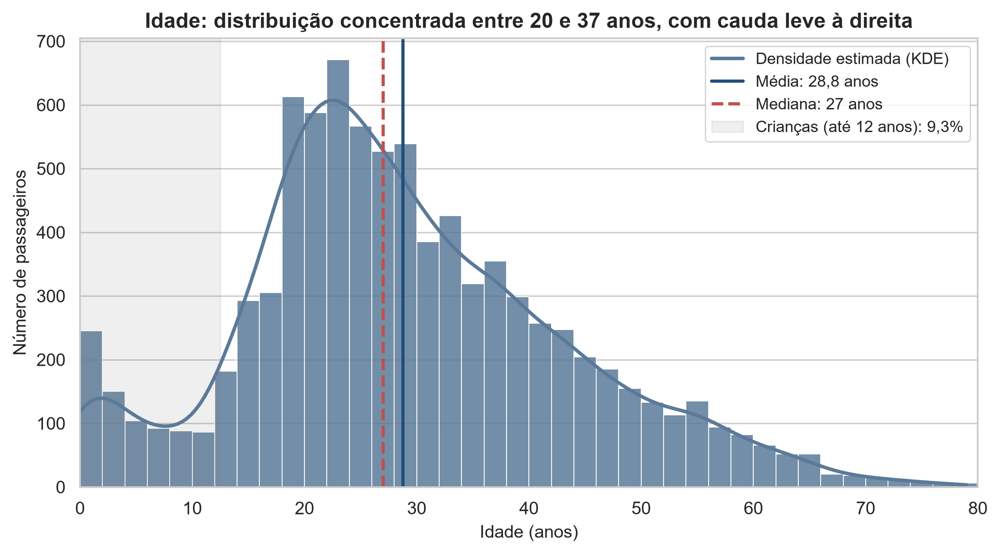
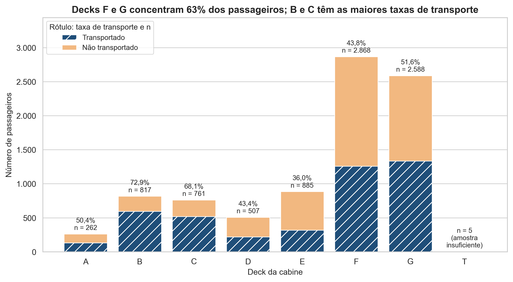
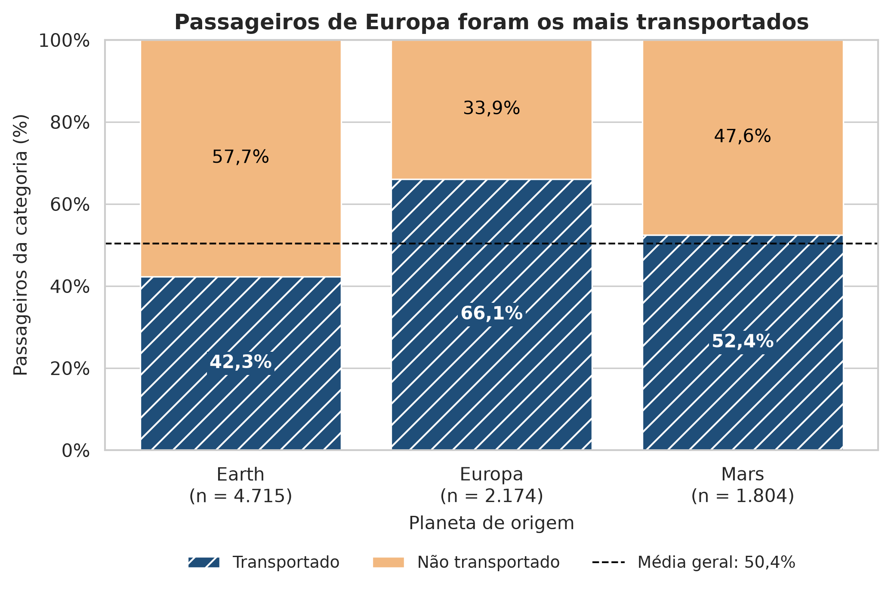
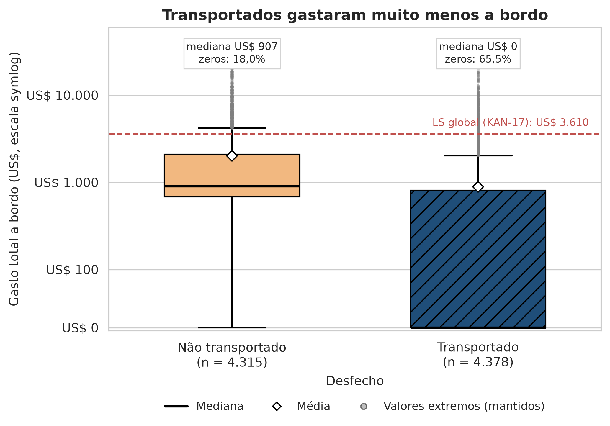
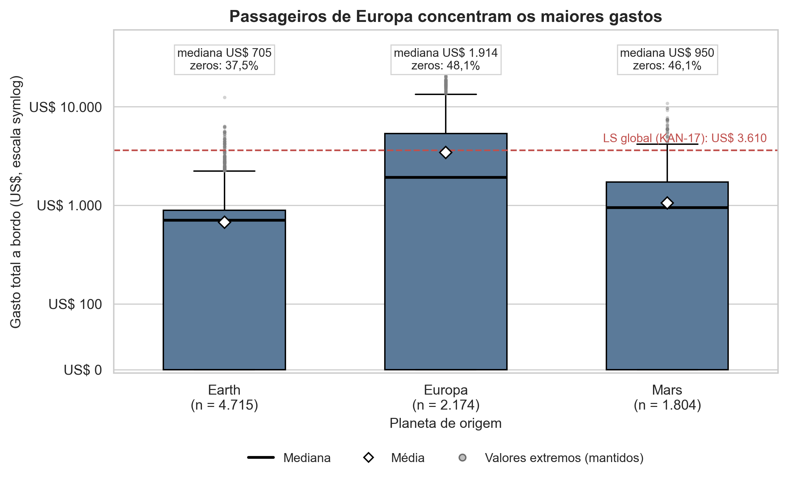
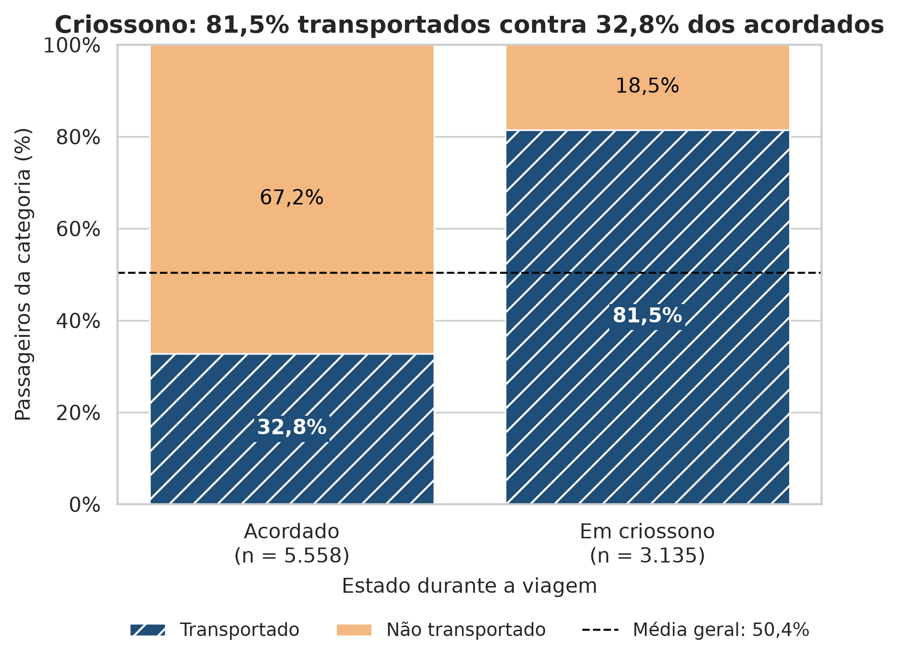
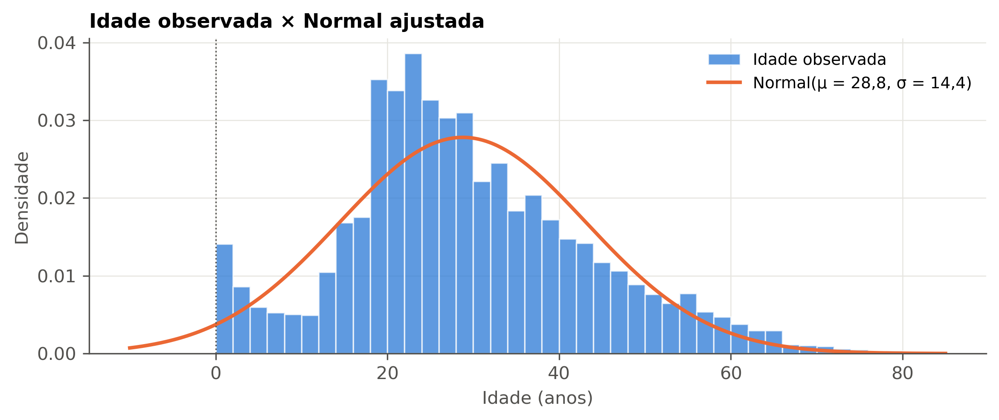
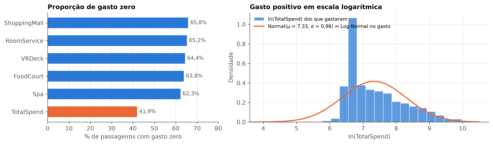

# Spaceship Titanic — Análise Estatística, Modelagem Preditiva e Recomendações Operacionais

> **Relatório Técnico Final — T3**  
> **Disciplina:** Estatística Avançada e Fundamentos Probabilísticos para IA  
> **Programa:** Pós-Graduação em Inteligência Artificial / Deep Learning — Centro de Informática (CIn/UFPE)  
> **Equipe Técnica:** Daniela Amaro, Renatta Batista, Gustavo Menezes Gonçalves, Helton Gomes Soares de Lima, Luciana Almeida  
> **Data:** Novembro de 2026  
> **Repositório do Projeto:** `https://github.com/gmenezesg/spaceship-titanic-estatistica-posdl`  
> **Artefatos Vinculados:** Notebook Mestre (`notebooks/00_projeto_final_estatistica.ipynb`), Catálogo de Figuras (`docs/catalogo_figuras.md`), Apresentação Executiva (`report/apresentacao_final.pdf`)

---

## 1. Resumo Executivo (Executive Summary)

### 1.1. Contexto do Incidente e Demanda Operacional
Durante a rota inaugural de transporte interplanetário da nave espacial *Spaceship Titanic*, transportando passageiros civis e tripulação da Terra com destino a colônias em Kepler-186f e 55 Cancri e, a embarcação colidiu com uma anomalia de feixe espaço-temporal nas imediações da nuvem de poeira interestelar de Alpha Centauri. O incidente resultou no teletransporte involuntário e abrupto de aproximadamente metade das pessoas a bordo para outra dimensão dimensional.

O presente estudo analítico foi encomendado pelo **Comando de Operações Espaciais e pela Força de Resgate da Frota**, com dois objetivos centrais:
1. **Compreensão Retrospectiva (Diagnóstico e Auditoria):** Mapear os perfis demográficos, as condições de viagem e os padrões de localização a bordo que exibem maior vulnerabilidade ao feixe de teletransporte, permitindo a apuração de responsabilidades, o acolhimento transparente das famílias e a revisão das normas de segurança para futuras naves de passageiros.
2. **Triagem e Priorização Preditiva (Resgate Ativo):** Desenvolver um mecanismo preditivo transparente e estatisticamente auditável para estimar a probabilidade de teletransporte de passageiros cuja situação permanece não rotulada nos arquivos de emergência, orientando as equipes de busca e a reconstrução de prontuários.

### 1.2. O Conjunto de Dados e Governança
A base tratada reúne **8.693 passageiros e 22 variáveis**, com **50,36% de transportados** (4.378). Os testes de ausência por coluna não detectaram associação com o desfecho a 5%. A análise não estabelece que os dados faltavam completamente ao acaso.

### 1.3. Três Achados Capitais da Investigação
As análises descritivas, inferenciais e multivariadas convergiram em três pilares analíticos:
1. **Criossono:** 81,47% dos passageiros em criossono foram transportados, contra 32,82% dos acordados. A diferença de 48,65 pontos percentuais descreve uma associação.
2. **Origem e cabine:** as taxas observadas foram 66,05% para Europa, 52,44% para Marte e 42,33% para Terra. Origem e convés se sobrepõem na amostra, o que limita sua interpretação separada.
3. **Gastos:** os não transportados gastaram em média US$ 2.011,89, ante US$ 891,15 entre os transportados. Na base completa, 41,92% não tiveram gastos. As medianas por desfecho foram US$ 907 e US$ 0, respectivamente.

### 1.4. Modelo Preditivo de Triagem
Um modelo linear supervisionado de Regressão Logística com padronização via *Pipeline* foi treinado em divisão estratificada de 80/20 ($N_{\text{teste}} = 1.739$, semente fixa $42$). O modelo atingiu:
- **Acurácia de Teste:** **$77{,}9\%$**, representando um incremento substancial de **$+25{,}5$ pontos percentuais** sobre o classificador ingênuo estratificado de referência ($52{,}4\%$).
- **Capacidade Discriminatória (ROC-AUC):** **$0{,}862$**, confirmando excelente separação estocástica.
- **F1-Score Equilibrado:** **$0{,}784$** (Precisão de $0{,}772$ e Recall/Sensibilidade de $0{,}796$).
- **Controle Multivariado:** Após o ajuste conjunto pelas demais variáveis, o estado de criossono sustentou um *Odds Ratio* ajustado de **$3{,}21$** (IC 95%: $[2{,}61; 3{,}94]$) e a procedência de Europa exibiu $OR = 3{,}97$ (IC 95%: $[2{,}58; 6{,}10]$).

### 1.5. Quadro-Resumo Executivo de Indicadores
A Tabela 1 condensa os parâmetros oficiais do estudo validados no notebook mestre do projeto.

| Indicador Estratégico | Valor / Parâmetro Oficial | Leitura Operacional para Decisores |
| :--- | :---: | :--- |
| **Amostra Analisada ($N$)** | $8.693$ passageiros | Universo completo dos registros de treino auditados |
| **Taxa Global de Sinistro** | $50{,}36\%$ ($4.378$ indivíduos) | Desfecho perfeitamente equilibrado entre as classes |
| **Impacto do Criossono** | $81{,}47\%$ vs $32{,}82\%$ ($\Delta = 48{,}65$ p.p.) | Principal critério de risco individual ($V = 0{,}467$) |
| **Gradiente por Origem** | Europa $66{,}05\%$, Marte $52{,}44\%$, Terra $42{,}33\%$ | Segregação espacial por conveses físicos ($V = 0{,}197$) |
| **Passageiros com Gasto Zero** | $41{,}92\%$ ($3.644$ passageiros) | Mediana dos transportados é zero; assimetria severa ($4{,}40$) |
| **Desempenho Logístico (Teste)** | Acurácia $77{,}9\%$ · ROC-AUC $0{,}862$ · F1 $0{,}784$ | Ganho de $+25{,}5$ p.p. sobre baseline ingênuo ($52{,}4\%$) |

---

## 2. Contexto do Problema, Governança e Engenharia de Dados

### 2.1. O Problema de Negócio e os Objetivos do Cliente
O cliente institucional desta análise é o **Comando de Operações Espaciais da Federação**, entidade responsável pela regulação da rota comercial e coordenação das forças de resposta a desastres espaciais. A perda de contato dimensional com 4.378 almas exige uma investigação técnica pautada em dados objetivos.

A meta analítica decompõe-se em duas vertentes complementares:
1. **Compreender:** Identificar quais atributos pessoais, cabines ocupadas, gastos e estados fisiológicos exibem correlação estatística com o teletransporte, discernindo o tamanho real do efeito da mera significância provocada pelo tamanho amostral expressivo ($N = 8.693$).
2. **Prever:** Fornecer um modelo probabilístico que ranqueie passageiros conforme o risco de teletransporte, permitindo que as equipes de emergência atribuam recursos limitados de salvamento às zonas e perfis prioritários.

### 2.2. Dicionário, Inventário e Mecânica de Dados Ausentes
O dataset original fornecido continha 8.693 linhas e 14 atributos heterogêneos. A investigação inicial realizou a checagem rigorosa de tipos, nulidades e duplicatas.

| Variável Original | Tipo Primitivo | Descrição Operacional | Nulos ($n$) | Taxa de Nulos |
| :--- | :---: | :--- | :---: | :---: |
| `PassengerId` | Texto (Chave) | Identificador único no formato `gggg_pp` (grupo e pessoa) | 0 | $0{,}00\%$ |
| `HomePlanet` | Categórica | Planeta de residência permanente (`Earth`, `Europa`, `Mars`) | 201 | $2{,}31\%$ |
| `CryoSleep` | Booleana | Confinamento voluntário em câmara criogênica durante a viagem | 217 | $2{,}50\%$ |
| `Cabin` | Texto | Código da acomodação física no formato `Deck/Num/Side` | 199 | $2{,}29\%$ |
| `Destination` | Categórica | Planeta de destino (`TRAPPIST-1e`, `55 Cancri e`, `PSO J318.5-22`) | 182 | $2{,}09\%$ |
| `Age` | Numérica | Idade cronológica do passageiro em anos terrestres | 179 | $2{,}06\%$ |
| `VIP` | Booleana | Contratação de serviço executivo/VIP de bordo | 203 | $2{,}34\%$ |
| `RoomService` | Contínua | Despesa acumulada em serviço de quarto de cabine (US$) | 181 | $2{,}08\%$ |
| `FoodCourt` | Contínua | Despesa acumulada na praça de alimentação e alta gastronomia | 183 | $2{,}11\%$ |
| `ShoppingMall` | Contínua | Despesa acumulada nas lojas comerciais da nave | 188 | $2{,}16\%$ |
| `Spa` | Contínua | Despesa acumulada em tratamentos estéticos e relaxamento | 183 | $2{,}11\%$ |
| `VRDeck` | Contínua | Despesa acumulada em entretenimento por realidade virtual | 188 | $2{,}16\%$ |
| `Name` | Texto | Nome de registro civil do passageiro | 200 | $2{,}30\%$ |
| `Transported` | Booleana (Alvo) | Ocorrência do sinistro de teletransporte (`True` / `False`) | 0 | $0{,}00\%$ |

O diagnóstico de integridade confirmou **zero duplicatas integrais de registros** e **zero duplicatas no identificador `PassengerId`**. 

Havia 2.324 valores ausentes distribuídos entre 2.087 passageiros. Os testes qui-quadrado por coluna compararam o indicador de ausência com `Transported`. Os valores-p acima de 0,05 e V de Cramér abaixo de 0,02 indicam que a análise não detectou associação com esse desfecho. Como outras características observadas e não observadas não foram avaliadas por esse diagnóstico, o mecanismo de ausência permanece indeterminado.

### 2.3. Saneamento e variáveis derivadas

O notebook 01 trata lacunas nas bases originais do Kaggle com regras de consistência e imputação. Células ausentes de gasto foram preenchidas com zero quando aplicável às regras de criossono e idade. Gastos observados positivos informaram a imputação de criossono quando esse campo estava ausente. A preparação usou vínculos de grupo, convés ou sobrenome onde previstos e modas de referência para categorias remanescentes.

A idade foi imputada pela mediana por planeta e status VIP. Gastos residuais foram imputados pela mediana por planeta, criossono e VIP, com mediana global quando necessário. As oito derivadas são `Group`, `GroupSize`, `IsAlone`, `CabinDeck`, `CabinNum`, `CabinSide`, `TotalSpend` e `HasSpent`. A base tratada ficou sem valores ausentes. A imputação precedeu a divisão interna de validação do modelo, discutida na seção 6.4.

---

## 3. Análise Descritiva e Visual dos Passageiros

### 3.1. Perfil Demográfico da Tripulação e Passageiros
A composição qualitativa da tripulação está sintetizada na Tabela T1 (selecionada no Catálogo de Figuras e Tabelas do `KAN-38`).

| Variável | Categoria | Frequência ($n$) | Proporção Relativa ($\%$) | Taxa de Transporte ($\%$) |
| :--- | :--- | :---: | :---: | :---: |
| **`Transported` (Alvo)** | `True` / `False` | $4.378$ / $4.315$ | $50{,}36\%$ / $49{,}64\%$ | — |
| **`HomePlanet`** | Terra (*Earth*) | $4.715$ | $54{,}24\%$ | $42{,}33\%$ |
| | Europa (*Europa*) | $2.174$ | $25{,}01\%$ | $66{,}05\%$ |
| | Marte (*Mars*) | $1.804$ | $20{,}75\%$ | $52{,}44\%$ |
| **`CryoSleep`** | Acordado (`False`) | $5.558$ | $63{,}94\%$ | $32{,}82\%$ |
| | Em Criossono (`True`) | $3.135$ | $36{,}06\%$ | $81{,}47\%$ |
| **`CabinSide`** | Boreste (`S`) | $4.395$ | $50{,}56\%$ | $55{,}43\%$ |
| | Bombordo (`P`) | $4.298$ | $49{,}44\%$ | $45{,}16\%$ |
| **`VIP`** | Não-VIP (`False`) | $8.494$ | $97{,}71\%$ | $50{,}65\%$ |
| | VIP (`True`) | $199$ | $2{,}29\%$ | $38{,}21\%$ |
| **`IsAlone`** | Grupo Familiar (`False`)| $3.888$ | $44{,}73\%$ | $55{,}58\%$ |
| | Solitário (`True`) | $4.805$ | $55{,}27\%$ | $46{,}24\%$ |

A análise da distribuição etária revela uma tripulação prioritariamente jovem: média de **$28{,}8$ anos** e mediana de **$27{,}0$ anos**, com desvio-padrão de $14{,}4$ anos e amplitude interquartil de $18{,}0$ anos ($Q_1 = 19, Q_3 = 37$). Nota-se uma assimetria positiva moderada ($0{,}43$) impulsionada pela presença de passageiros idosos de até 79 anos e por uma concentração atípica de 809 crianças com até 12 anos ($9{,}31\%$ da base), incluindo 178 lactentes com idade registrada zero.

  
*Figura 3 — Distribuição da idade dos passageiros ($N = 8.693$). Histograma com classes de 2 anos e curva KDE estimada. Observa-se concentração no intervalo de 20 a 35 anos e o pico singular em idade 0 (bebês a bordo).*

### 3.2. Estrutura Espacial das Cabines e Conveses
A ocupação foi desigual entre os conveses. Os decks F e G concentram nada menos que **$62{,}76\%$ de toda a população** ($2.868$ e $2.588$ passageiros, respectivamente). A Tabela T3 destaca as maiores disparidades de sinistro observadas entre os conveses.

| Convés (`CabinDeck`) | População ($n$) | Participação ($\%$) | Transportados ($n$) | Taxa de Transporte ($\%$) | Planetas Predominantes |
| :---: | :---: | :---: | :---: | :---: | :--- |
| **B** | $779$ | $8{,}96\%$ | $568$ | **$72{,}95\%$** | Europa ($94{,}7\%$) |
| **C** | $747$ | $8{,}59\%$ | $508$ | **$68{,}07\%$** | Europa ($95{,}2\%$) |
| **A** | $256$ | $2{,}94\%$ | $127$ | **$49{,}61\%$** | Europa ($98{,}4\%$) |
| **D** | $495$ | $5{,}69\%$ | $215$ | **$43{,}43\%$** | Marte ($58\%$) / Europa ($42\%$) |
| **E** | $876$ | $10{,}08\%$ | $313$ | **$35{,}73\%$** | Terra ($45\%$) / Marte ($39\%$) / Europa ($16\%$) |
| **F** | $2.868$ | $32{,}99\%$ | $946$ | **$32{,}99\%$** | Marte ($54\%$) / Terra ($46\%$) |
| **G** | $2.588$ | $29{,}77\%$ | $898$ | **$34{,}70\%$** | Terra ($100{,}0\%$) |
| **T** | $5$ | $0{,}06\%$ | $1$ | **$20{,}00\%$** | Conves técnico / Amostra insuficiente |

  
*Figura 6 — Ocupação física e taxa de sinistro por deck da cabine ($N = 8.693$). Conveses B e C apresentam as maiores taxas de teletransporte, com alta concentração de passageiros de Europa. O deck T figura isolado devido ao tamanho amostral residual ($n = 5$).*

  
*Figura 1 — Taxa de transporte por planeta de procedência ($N = 8.693$). A linha tracejada demarca a média global da embarcação ($50{,}36\%$). Passageiros europeus sofrem o maior impacto relativo ($66{,}05\%$).*

As taxas por planeta e por convés devem ser lidas em conjunto. Na base tratada, 72,6% dos passageiros de Europa estavam nos conveses B e C. Essa sobreposição dificulta separar as associações com origem e localização.

### 3.3. Padrões de Consumo e Valores Extremos (Outliers)
As cinco rubricas de consumo monetário a bordo exibem comportamento assimétrico e altamente atípico. A Tabela T2 detalha a distribuição das variáveis financeiras.

| Rubrica Financeira | Zeros ($n$) | Proporção Zeros ($\%$) | Mediana (US$) | Média (US$) | Desvio-Padrão (US$) | Máximo (US$) | Coef. Variação ($CV$) |
| :--- | :---: | :---: | :---: | :---: | :---: | :---: | :---: |
| `RoomService` | $5.577$ | $64{,}16\%$ | $0{,}00$ | $220{,}01$ | $660{,}54$ | $14.327{,}00$ | $3{,}00$ |
| `FoodCourt` | $5.456$ | $62{,}76\%$ | $0{,}00$ | $448{,}43$ | $1.595{,}60$ | $29.813{,}00$ | $3{,}56$ |
| `ShoppingMall`| $5.587$ | $64{,}27\%$ | $0{,}00$ | $169{,}57$ | $597{,}94$ | $23.492{,}00$ | $3{,}53$ |
| `Spa` | $5.324$ | $61{,}24\%$ | $0{,}00$ | $304{,}59$ | $1.125{,}56$ | $22.408{,}00$ | $3{,}70$ |
| `VRDeck` | $5.495$ | $63{,}21\%$ | $0{,}00$ | $298{,}25$ | $1.134{,}26$ | $24.133{,}00$ | $3{,}80$ |
| **`TotalSpend`** | **$3.644$** | **$41{,}92\%$** | **$716{,}00$** | **$1.445{,}46$** | **$2.793{,}55$** | **$35.987{,}00$** | **$1{,}93$** |

A assimetria global de `TotalSpend` é de **$4{,}40$**, com curtose em excesso de **$27{,}28$**. Pelo critério de Tukey (KAN-17), utilizando o intervalo interquartil ($Q_1 = 0, Q_3 = 1.444, IQR = 1.444$), o limiar superior de valores extremos fixou-se em **US$ 3.610,00** ($Q_3 + 1{,}5 \times IQR$). Foram detectados **992 passageiros ($11{,}41\%$)** classificados como *outliers* superiores.

Os valores extremos foram mantidos para preservar a dispersão observada. O critério de Tukey sinaliza valores atípicos na distribuição e não identifica erros de registro.

  
*Figura 4 — Gasto total consolidado (`TotalSpend`) por desfecho em escala symlog ($N = 8.693$). A linha tracejada assinala o corte de outliers ($US\$ 3.610,00$). Nota-se o colapso da mediana dos transportados para zero.*

  
*Figura 5 — Gasto total por planeta de procedência em escala symlog ($N = 8.693$). Europa apresenta mediana de despesa quase três vezes superior à da Terra, evidenciando o abismo econômico entre as origens.*

  
*Figura 2 — Associação bivariada entre confinamento em criossono e teletransporte ($N = 8.693$). O criossono está associado a uma diferença brutal de 48,65 p.p. no risco de sinistro.*
*Figura 2 — Taxa observada de transporte por estado de criossono. A diferença entre os grupos foi de 48,65 pontos percentuais.*
---

## 4. Probabilidade, Variáveis Aleatórias e Distribuições

### 4.1. Variáveis Aleatórias Discretas e Processos de Bernoulli
O desfecho operacional `Transported` foi formalizado como uma **variável aleatória de Bernoulli**, onde:
$$Y \sim \text{Bernoulli}(p), \quad p = P(Y = 1) = \frac{4.378}{8.693} \approx 0{,}5036$$
A variância estimada está próxima do máximo de 0,25:
$$\sigma_Y^2 = p(1 - p) = 0{,}5036 \times 0{,}4964 \approx 0{,}2499 \quad (\sigma_Y \approx 0{,}5000)$$
A proporção amostral atua, portanto, como a medida canônica central. Em virtude do equilíbrio ($50{,}36\%$), qualquer classificador que pretenda demonstrar utilidade operacional deve ser comparado com classificadores de referência no mesmo conjunto de avaliação.

Similarmente, o estado de sono criogênico modela-se como:
$$C \sim \text{Bernoulli}(p_c), \quad p_c = \frac{3.135}{8.693} \approx 0{,}3606$$

### 4.2. Investigação Formal de Aderência Teórica: Idade
A idade foi registrada em anos inteiros, com concentração em zero. Na base tratada, a média foi 28,78 e o desvio-padrão, 14,35 anos. O QQ-plot do notebook 03 mostra a maioria dos pontos centrais abaixo da reta. O histograma e os diagnósticos Shapiro–Wilk (W = 0,980, p aproximado de 3,46 × 10⁻³³) e Lilliefors (D = 0,076, p aproximado de 2,50 × 10⁻¹³⁶) indicam desvio da Normal. A exclusão dos registros de idade zero aumentou D para 0,085. Acima de 5.000 observações, o valor-p de Shapiro–Wilk pode ser impreciso. W e D são estatísticas de diagnóstico, e D mede a distância máxima entre as funções de distribuição. [Documentação do SciPy](https://docs.scipy.org/doc/scipy/reference/generated/scipy.stats.shapiro.html).

### 4.3. Gastos zero e distribuição dos valores positivos

Na base completa, 41,92% dos gastos totais são zero, a assimetria é 4,40 e a curtose em excesso é 27,28. Nos 5.049 gastos positivos, o diagnóstico de `log1p(TotalSpend)` encontrou assimetria de −0,19 e curtose em excesso de 4,93. A comparação com o total bruto muda tanto a escala quanto a população. A Figura 8 usa o log natural dos gastos positivos. Os testes foram aplicados ao log de um mais o gasto.

No recorte positivo transformado, Shapiro–Wilk produziu W = 0,891 (p aproximado de 8,57 × 10⁻⁵¹) e Lilliefors produziu D = 0,126 (p aproximado de 1,14 × 10⁻²²²). Os diagnósticos e o QQ-plot mostram desvios da Normal, mesmo após transformação. Os valores-p de Shapiro recebem a mesma ressalva de tamanho amostral aplicada à idade.

### 4.4. Escolha dos testes inferenciais

O teste t de Welch compara médias de gasto por desfecho e a ANOVA de Welch compara médias entre planetas. Ambos admitem variâncias desiguais. Os desvios-padrão de gasto são US$ 3.142,61 e US$ 2.302,98 entre não transportados e transportados, respectivamente. Entre Terra, Europa e Marte, são US$ 788,02, US$ 4.825,46 e US$ 1.347,61. Isso corresponde a razões entre a maior e a menor variância de cerca de 1,86 e 37,50, respectivamente, em linha com os diagnósticos de Levene centrado na mediana. Os grupos grandes favorecem a aproximação para médias sob independência e variâncias finitas. Games–Howell estima contrastes entre médias de planetas com variâncias e tamanhos desiguais.

Mann–Whitney bilateral e Kruskal–Wallis comparam postos. São complementares porque respondem a perguntas distintas das comparações de médias. Os zeros geram muitos empates, tratados nos cálculos. Diferenças de forma e dispersão podem contribuir para a rejeição, portanto as medianas são descritas separadamente. Os testes convencionais pressupõem observações independentes. O agrupamento por viagem pode afetar os valores-p e intervalos, e a inferência com ajuste por grupo não foi estimada. [SciPy — Mann–Whitney](https://docs.scipy.org/doc/scipy/reference/generated/scipy.stats.mannwhitneyu.html) e [SciPy — Kruskal–Wallis](https://docs.scipy.org/doc/scipy/reference/generated/scipy.stats.kruskal.html).

---

## 5. Inferência Estatística, Testes de Hipóteses e ANOVA

### 5.1. Protocolo Formal e Tabela-Resumo Consolidada (KAN-28)
O nível nominal é 5% por teste. Games–Howell e Dunn–Bonferroni ajustam as comparações dentro de suas respectivas famílias. A tabela não presume controle global entre todas as perguntas. Resultados arredondados a zero pela rotina numérica são apresentados com limite conservador, sem afirmar valor-p literal zero.

| Pergunta de Pesquisa / Relação | Hipótese Nula ($H_0$) e Alternativa ($H_1$) | Teste Estatístico Aplicado | Pressupostos e diagnósticos | Estatística do Teste | Valor-$p$ Observado | Tamanho do Efeito | Decisão ($\alpha=0{,}05$) | Conclusão e Significado de Negócio |
| :--- | :--- | :--- | :--- | :--- | :--- | :--- | :--- | :--- |
| **P1: `HomePlanet` $\times$ `Transported`** | $H_0$: Variáveis independentes $H_1$: Há associação | Qui-Quadrado de Pearson | Frequências esperadas $\ge 5$ atendidas ($100\%$; mín: $895{,}5$) | $\chi^2 = 338{,}82$ ($df = 2$) | $2{,}66 \times 10^{-74}$ | $V \text{ de Cramér} = 0{,}197$ (Associação média) | **Rejeita $H_0$** | Europa apresentou maior taxa observada que Marte e Terra. |
| **P2: `CryoSleep` $\times$ `Transported`** | $H_0$: Variáveis independentes $H_1$: Há associação | Qui-Quadrado de Pearson (sem Yates) | Frequências esperadas $\ge 5$ atendidas ($100\%$; mín: $1.556{,}1$) | $\chi^2 = 1.897{,}71$ ($df = 1$) | $< 0{,}001$ | $V \text{ de Cramér} = 0{,}467$ (Associação muito forte) | **Rejeita $H_0$** | O grupo em criossono apresentou maior taxa observada de transporte. |
| **P3: `VIP` $\times$ `Transported`** | $H_0$: Variáveis independentes $H_1$: Há associação | Qui-Quadrado de Pearson (sem Yates) | Frequências esperadas $\ge 5$ atendidas ($100\%$; mín: $98{,}8$) | $\chi^2 = 12{,}07$ ($df = 1$) | $5{,}13 \times 10^{-4}$ | $V \text{ de Cramér} = 0{,}037$ (Associação desprezível) | **Rejeita $H_0$** | Associação de pequena magnitude na amostra. |
| **P4: `TotalSpend` por `Transported` (Paramétrico)** | $H_0$: $\mu_{\text{Não}} = \mu_{\text{Sim}}$ $H_1$: $\mu_{\text{Não}} \neq \mu_{\text{Sim}}$ | Teste $t$ de Welch (Amostras Independentes) | Levene refuta homocedasticidade ($W = 131{,}36, p < 0{,}001$); aproximação para médias em grupos grandes, sob independência | $t = 18{,}94$ ($df = 7.906{,}3$) | $2{,}67 \times 10^{-78}$ | $d \text{ de Cohen} = 0{,}407$ (Efeito moderado; $\Delta = +\$1.120{,}74$) | **Rejeita $H_0$** | O gasto médio foi maior entre os não transportados. |
| **P4: `TotalSpend` por `Transported` (Não-Paramétrico)** | $H_0$: Distribuições iguais $H_1$: Diferença entre distribuições na comparação por postos | Teste $U$ de Mann-Whitney (Wilcoxon) | Independência assumida; correção de empates e continuidade | $U = 13.846.861{,}5$ ($Z = 39{,}09$) | $< 0{,}001$ | $r \text{ de Rosenthal} = 0{,}419$ (Efeito moderado) | **Rejeita $H_0$** | Os postos de gasto diferiram entre os grupos. A mediana foi US$ 0 entre transportados e US$ 907 entre não transportados. |
| **P5: `TotalSpend` por `HomePlanet` (Paramétrico)** | $H_0$: $\mu_{\text{Terra}} = \mu_{\text{Europa}} = \mu_{\text{Marte}}$ $H_1$: Ao menos uma difere | ANOVA de Welch a Um Fator (*One-Way*) | Levene indica severa heterocedasticidade ($W = 1.592{,}08, p < 0{,}001$); Welch robusto | $F = 407{,}57$ ($df_1 = 2, df_2 = 3.000{,}9$) | $2{,}57 \times 10^{-157}$ | $\eta^2 = 0{,}1714$ ($\omega^2 = 0{,}1712$; Efeito grande) | **Rejeita $H_0$** | Houve evidência de diferenças de médias de gasto entre planetas. η² descreve a fração da variabilidade amostral associada aos grupos. |
| **P5: `TotalSpend` por `HomePlanet` (Não-Paramétrico)**| $H_0$: Postos de gasto idênticos $H_1$: Ao menos um planeta difere | Teste de Kruskal-Wallis ($H$) | Independência assumida; empates tratados | $H = 271{,}97$ ($df = 2$) | $8{,}77 \times 10^{-60}$ | $\epsilon^2 = 0{,}0313$ (Efeito ordinal relevante) | **Rejeita $H_0$** | Houve evidência de diferenças globais nos postos de gasto. |
| **P5 (Pós-Hoc): Europa vs Terra** | $H_0$: $\mu_{\text{Europa}} = \mu_{\text{Terra}}$ $H_1$: $\mu_{\text{Europa}} \neq \mu_{\text{Terra}}$ | Procedimento Pós-Hoc de Games-Howell | Controle familiar de erro Tipo I sob variâncias desiguais | $q = 37{,}60$ ($df = 2.226{,}6$) | $4{,}94 \times 10^{-13}$ | $\Delta = +\$2.768{,}76$ (IC 95%: $[\$2.524{,}55; \$3.012{,}96]$) | **Rejeita $H_0$** | Europa apresentou maior gasto médio que Terra. |
| **P5 (Pós-Hoc): Europa vs Marte** | $H_0$: $\mu_{\text{Europa}} = \mu_{\text{Marte}}$ $H_1$: $\mu_{\text{Europa}} \neq \mu_{\text{Marte}}$ | Procedimento Pós-Hoc de Games-Howell | Variâncias e amostras desiguais compensadas | $q = 31{,}15$ ($df = 2.573{,}3$) | $< 0{,}001$ | $\Delta = +\$2.384{,}27$ (IC 95%: $[\$2.130{,}42; \$2.638{,}11]$) | **Rejeita $H_0$** | Europa apresentou maior gasto médio que Marte. |
| **P5 (Pós-Hoc): Marte vs Terra** | $H_0$: $\mu_{\text{Marte}} = \mu_{\text{Terra}}$ $H_1$: $\mu_{\text{Marte}} \neq \mu_{\text{Terra}}$ | Procedimento Pós-Hoc de Games-Howell | Controle sob heterocedasticidade moderada | $q = 16{,}12$ ($df = 2.290{,}6$) | $1{,}20 \times 10^{-12}$ | $\Delta = +\$384{,}49$ (IC 95%: $[\$305{,}36; \$463{,}61]$) | **Rejeita $H_0$** | Marte apresentou maior gasto médio que Terra. |

### 5.2. Tamanhos de efeito e análise complementar

A tabela reporta V de Cramér para todas as associações categóricas significantes e diferenças de médias ou magnitudes padronizadas para cada comparação de gastos. V = 0,037 indica associação pequena para VIP, enquanto V = 0,467 indica associação mais pronunciada para criossono. O valor-p informa a evidência contra a hipótese nula sob os pressupostos do teste. A magnitude responde à relevância prática. As razões de variância na seção 4.4 contextualizam os dois diagnósticos de Levene.

Dunn–Bonferroni complementou Kruskal–Wallis. As diferenças abaixo, na escala dos postos médios globais, indicam direção e magnitude observadas e dependem da amostra. Elas não expressam diferenças monetárias.

| Contraste | Diferença de postos médios (primeiro menos segundo) | Valor-p ajustado |
| --- | ---: | ---: |
| Terra – Europa | −1.027,32 | 5,18 × 10⁻⁶⁰ |
| Terra – Marte | −431,16 | 3,40 × 10⁻¹⁰ |
| Europa – Marte | +596,16 | 2,76 × 10⁻¹⁴ |

### 5.3. Criossono e interpretação observacional

As regras de preparação e os registros observados relacionam criossono e gasto zero. Como o criossono também está associado ao desfecho, é uma explicação possível para parte da diferença de gasto entre transportados e não transportados. O estudo não identifica efeitos de gastar ou permanecer em criossono sobre o transporte.

---

## 6. Correlações, Regressão e Modelagem Preditiva Multivariada

### 6.1. Matriz de Correlação Bivariada: Pearson vs Spearman
Avaliou-se a estrutura de correlação entre as 8 variáveis numéricas contínuas e discretas do dataset. Dada a severa assimetria e caudas pesadas das despesas, comparou-se a matriz paramétrica linear de **Pearson ($r$)** com a matriz ordinal não-paramétrica de **Spearman ($\rho$)**.

| Par de Variáveis Analisado | Pearson ($r$) | Spearman ($\rho$) | Interpretação Metodológica |
| :--- | :---: | :---: | :--- |
| `FoodCourt` $\times$ `TotalSpend` | **$0{,}75$** | **$0{,}67$** | Associação descritiva na base completa. |
| `VRDeck` $\times$ `TotalSpend` | $0{,}57$ | $0{,}59$ | Associação descritiva na base completa. |
| `Spa` $\times$ `TotalSpend` | $0{,}56$ | $0{,}57$ | Associação descritiva na base completa. |
| `FoodCourt` $\times$ `VRDeck` | $0{,}23$ | **$0{,}52$** | Associação descritiva na base completa. |
| `FoodCourt` $\times$ `Spa` | $0,22$ | **$0{,}49$** | Associação descritiva na base completa. |
| `Age` $\times$ `GroupSize` | **$-0{,}19$** | **$-0{,}18$** | Associação descritiva na base completa. |
| `Age` $\times$ `TotalSpend` | $+0{,}11$ | $+0{,}13$ | Associação descritiva na base completa. |

O notebook 05 mostra que as associações entre serviços mudam ao restringir a análise a quem gastou. Os zeros compartilhados podem influenciar as correlações da amostra completa.

### 6.2. Diagnóstico de Multicolinearidade
O VIF de `HomePlanet_Europa` foi 7,99 na amostra completa e 7,98 no treino da regressão linear. A concentração de passageiros de alguns planetas em determinados conveses limita a interpretação isolada desses fatores. Esses VIFs descrevem os desenhos avaliados para a regressão linear.

### 6.3. Modelo secundário de gastos

A regressão linear ajustou `log1p(TotalSpend)` em função de idade, tamanho do grupo, origem, convés e VIP. O R² ajustado no treino foi 0,256. O RMSE no teste foi 3,18 na escala logarítmica. O diagnóstico de resíduos indicou heterocedasticidade e estrutura compatível com a mistura de gastos nulos e positivos. Os erros-padrão HC3 ajustam a estimativa de incerteza dos coeficientes diante de heterocedasticidade. A forma da distribuição dos resíduos permanece uma limitação do ajuste.

### 6.4. Modelo Preditivo Principal: Regressão Logística para `Transported`
A regressão logística binária foi estimada por máxima verossimilhança **sem penalização**. O pipeline codifica criossono, origem, destino, convés, bordo e VIP. Padroniza idade e tamanho do grupo e aplica `log1p` seguido de padronização às cinco rubricas de gasto. As referências categóricas são False, Terra, TRAPPIST-1e, F, boreste e False, nessa ordem.

A divisão interna por passageiro foi estratificada pelo desfecho, com 6.954 observações de treino e 1.739 de teste e semente 42. A codificação, a padronização e a estimação do modelo usaram o treino interno. A limpeza e a imputação da base Kaggle ocorreram antes dessa divisão. Estatísticas usadas no saneamento podem incorporar informação das futuras observações de teste interno, limitando a interpretação da avaliação como desempenho em dados completamente novos. O limiar de 0,50 foi fixado antes da avaliação.

#### Avaliação de desempenho contra o classificador de referência

A tabela compara a logística com o classificador ingênuo estratificado no teste interno.

| Métrica de Desempenho | Baseline Estratificado | Modelo Logístico Proposto | Diferença observada |
| :--- | :---: | :---: | :---: |
| **Acurácia Global (*Accuracy*)** | $52{,}4\%$ | **$77{,}9\%$** | **$+25{,}5$ pontos percentuais** |
| **Área sob a Curva ROC (ROC-AUC)** | $0{,}524$ | **$0{,}862$** | **$+0{,}338$ ** |
| **F1 da classe positiva** | $0{,}525$ | **$0{,}784$** | **$+0{,}259$ ** |
| **Sensibilidade / Revocação (*Recall*)** | $0{,}523$ | **$0{,}796$** | $+0{,}273$  |
| **Precisão (*Precision*)** | $0{,}528$ | **$0{,}772$** | $+0{,}244$  |

O pseudo-R² de McFadden foi 0,311 no treino. No teste, ao limiar de 0,50, a matriz de confusão contém **657 verdadeiros negativos, 206 falsos positivos, 179 falsos negativos e 697 verdadeiros positivos**. A sensibilidade foi de aproximadamente 79,6%.

#### Interpretação dos Odds Ratios (Razões de Chance)
Para conferir inteligibilidade técnica, os coeficientes logísticos estimados no treino foram convertidos em **Odds Ratios ($OR = e^{\beta}$)** acompanhados de seus respectivos Intervalos de Confiança assintóticos de 95%.

| Variável / Preditor | Coeficiente ($\beta$) | Erro-Padrão ($SE$) | *Odds Ratio* ($OR$) | IC 95% do *Odds Ratio* | Interpretação em Lógica de Negócio |
| :--- | :---: | :---: | :---: | :---: | :--- |
| **`HomePlanet_Europa`** | $1{,}3781$ | $0{,}2199$ | **$3{,}97$** | $[2{,}58; 6{,}10]$ | Europa em relação à Terra. |
| **`CryoSleep_True`** | $1{,}1656$ | $0{,}1052$ | **$3{,}21$** | $[2{,}61; 3{,}94]$ | Criossono em relação ao estado acordado. |
| **`FoodCourt` (por 1 DP de `log1p`)** | $0{,}3899$ | $0{,}0414$ | **$1{,}48$** | $[1{,}36; 1{,}60]$ | Maior chance ajustada a cada DP de gasto transformado. |
| **`HomePlanet_Mars`** | $0{,}3376$ | $0{,}1053$ | **$1{,}40$** | $[1{,}14; 1{,}72]$ | Marte em relação à Terra. |
| **`ShoppingMall` (por 1 DP de `log1p`)**| $0{,}2111$ | $0{,}0348$ | **$1{,}24$** | $[1{,}15; 1{,}32]$ | Maior chance ajustada a cada DP de gasto transformado. |
| **`CabinSide_P` (Bombordo)** | $-0{,}5172$ | $0{,}0611$ | **$0{,}60$** | $[0{,}53; 0{,}67]$ | Bombordo em relação a boreste. |
| **`RoomService` (por 1 DP de `log1p`)** | $-0{,}6020$ | $0{,}0397$ | **$0{,}55$** | $[0{,}51; 0{,}59]$ | Menor chance ajustada a cada DP de gasto transformado. |
| **`CabinDeck_G`** | $-0{,}6377$ | $0{,}0957$ | **$0{,}53$** | $[0{,}44; 0{,}64]$ | Convés G em relação ao convés F. |
| **`Spa` (por 1 DP de `log1p`)** | $-0{,}7436$ | $0{,}0406$ | **$0{,}48$** | $[0{,}44; 0{,}51]$ | Menor chance ajustada a cada DP de gasto transformado. |

Os ORs são razões de chances ajustadas e não equivalem a razões de probabilidades. A associação de criossono deve ser lida em conjunto com o padrão de gasto zero. O OR de Europa depende dos conveses em que há sobreposição entre origens. Para o deck T, a contagem reduzida torna a estimativa instável. O modelo assume termos aditivos e relação linear no logito nas escalas das preditoras numéricas. A forma funcional e a calibração não foram validadas. Os ICs assintóticos devem ser lidos como exploratórios diante do possível agrupamento de passageiros.

---

## 7. Conclusões, Recomendações e Próximos Passos

### 7.1. Síntese dos resultados

Criossono, origem e cabine estão associados às taxas de transporte na base tratada. A comparação de gastos mostra diferenças de médias e de postos, numa distribuição com muitos zeros. A regressão logística atingiu acurácia de 77,9% e ROC-AUC de 0,862 no teste interno. Esses resultados permitem priorizar hipóteses para investigação.

### 7.2. Recomendações ao comando operacional

1. Conferir os registros das cápsulas de criossono e a distribuição dos passageiros pelos conveses, onde foram observadas diferenças de taxa de transporte.
2. Investigar conjuntamente origem, cabine e gasto. As variáveis disponíveis não identificam mecanismos físicos, renda, evacuação ou sobrevivência.
3. Comunicar médias para comparações de consumo agregado e medianas e proporções de zeros para caracterizar a distribuição de gasto.
4. Avaliar o modelo como apoio à triagem em dados futuros. Definir custos dos erros, escolher o limiar em dados de validação separados e avaliar discriminação, calibração e desempenho com divisão por grupo antes de uso operacional.

### 7.3. Limitações metodológicas

- **Dados observacionais e imputados.** As associações não permitem atribuir causas. O teste de ausência em relação ao desfecho não estabelece MCAR. A análise de sensibilidade da preparação mediu a alteração das proporções e taxas em categorias avaliadas.
- **Dependência e validação interna.** Passageiros de um mesmo grupo, identificado por `Group`, podem aparecer em treino e teste. `GroupSize` é apenas o tamanho do grupo. A inferência não ajustou a dependência intragrupo e o teste interno se baseou em uma única partição da base previamente imputada. Isso pode afetar a incerteza e tornar as métricas otimistas, em magnitude desconhecida.
- **Generalização e decisão.** As métricas de teste não têm intervalos de incerteza, avaliação em novos grupos ou validação externa. A ROC-AUC mede discriminação. A calibração das probabilidades e a escolha de outro limiar exigem avaliação própria.
- **Especificação e sobreposição.** A linearidade no logito para termos numéricos foi assumida. Grupos raros e a concentração de origens em determinados conveses limitam a interpretação dos ORs ajustados.

### 7.4. Próximos Passos na Governança do Projeto
A conclusão do presente relatório técnico consolidado (**`KAN-39`**) desbloqueia a etapa subsequente de governança:
- **`KAN-40` — Revisão de Coerência Metodológica:** A cargo de **Luciana Almeida** (com co-revisão de Daniela Amaro e Renatta Batista), cujo objetivo é auditar o alinhamento cruzado entre as premissas de distribuições (Seção 4), a adequação dos testes inferenciais (Seção 5) e as conclusões interpretativas aqui formuladas.
- **`KAN-41` — Validação Numérica Cruzada:** Conduzida por **Daniela Amaro**, conferindo cada número, percentagem e intervalo de confiança deste relatório contra a saída de execução limpa do notebook consolidado mestre (`notebooks/00_projeto_final_estatistica.ipynb`).
- **`KAN-42` e `KAN-43` — Diagramação em PDF e Empacotamento Final:** Geração do documento oficial paginado em PDF para submissão à banca examinadora da Pós-Graduação em Deep Learning do CIn/UFPE.

---

*Relatório técnico consolidado no âmbito do card **KAN-39**, com dados auditados em 11 de novembro de 2026.*
